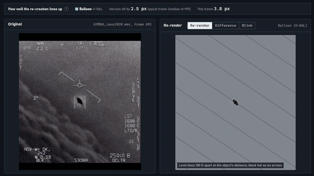
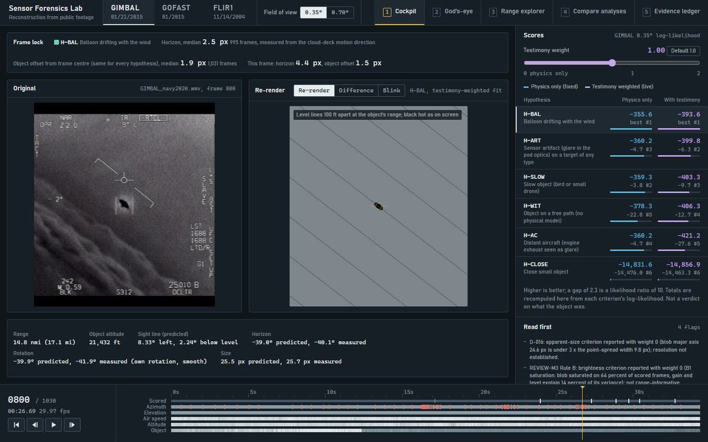
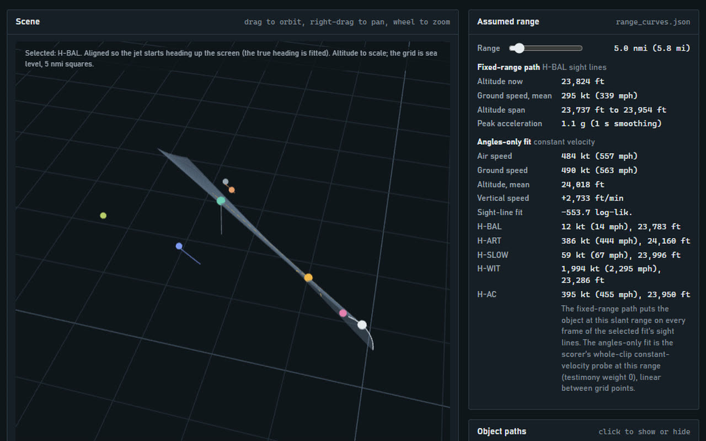
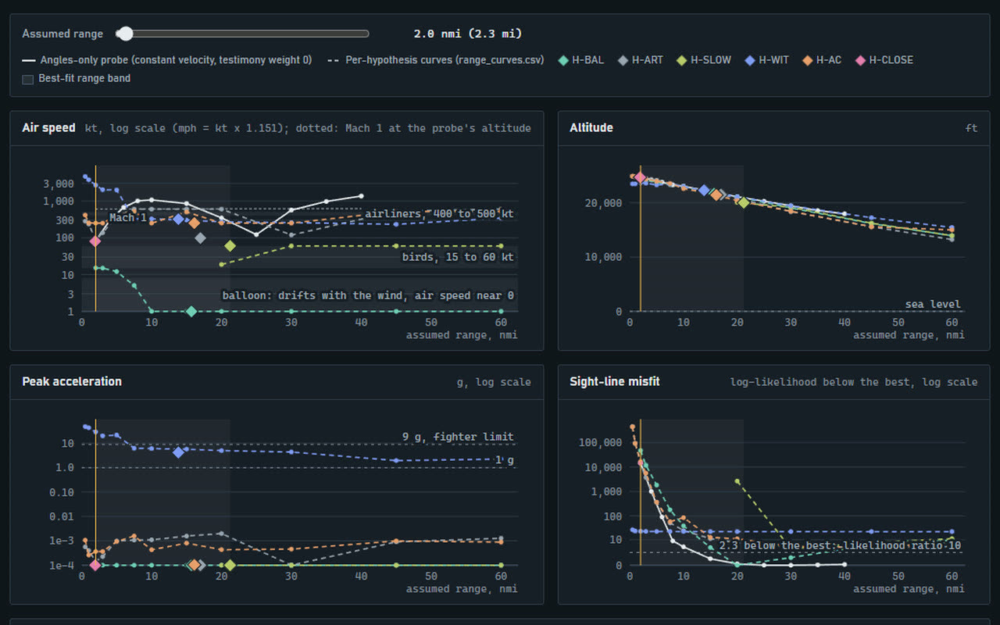
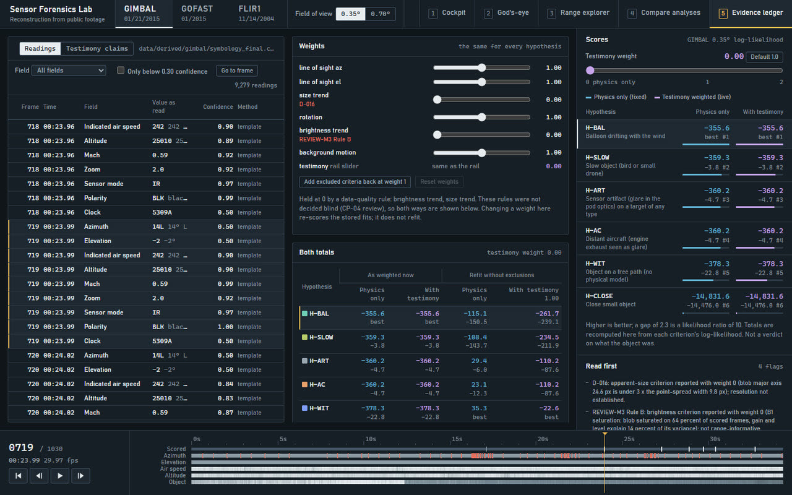
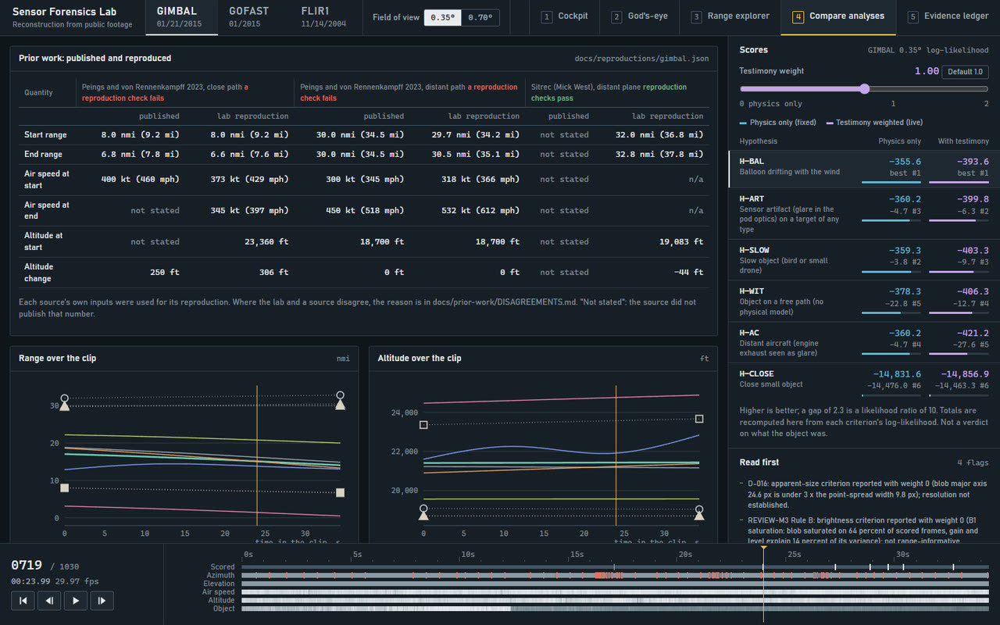
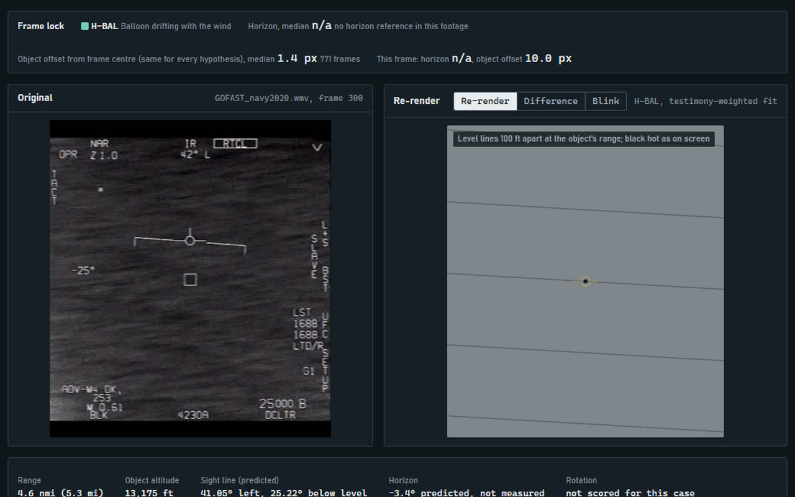

# Sensor Forensics Lab


The GIMBAL, GOFAST and Tic Tac videos rebuilt frame by frame, and six explanations scored against them with the same math.



**[Landing page](https://sensor-forensics.pages.dev)** · **[Open the lab](https://sensor-forensics.pages.dev/lab/)**

## What it is

A forensic reconstruction of what the sensors saw in four sets of military videos:

- **GIMBAL** (January 2015, F/A-18F, ATFLIR pod, infrared)
- **GOFAST** (January 2015, ATFLIR, infrared, with range on screen)
- **FLIR1 / "Tic Tac"** (November 2004, USS Nimitz group)
- **PURSUE**: the 134 sensor videos released by the Department of War in 2026 (8 bounded clips analyzed)

For each video the lab reads every number on screen, frame by frame, rebuilds the jet's path and the camera's line of sight, and then scores six explanations against the footage and the witness testimony with the same geometry and the same scoring for all of them. It tests hypotheses; it does not set out to confirm any belief.

The lab runs in the browser at https://sensor-forensics.pages.dev/lab/, or on your own PC (see "Open the app" below).

## Screenshots

| | |
|---|---|
|  |  |
|  |  |
|  |  |

## What it found, in plain words

The full results, with every number and its source, are in `docs/results/` (one page per video). In short:

- **GOFAST:** the on-screen range puts the object near 13,200 ft and about 3.8 nmi away. A balloon drifting with the wind, a slow flier and a glare on a slow target all fit the same path, and the data cannot tell them apart. An independent wind measurement at 13,200 ft, good to about 4 kt, would separate the balloon from the free-path object, but the balloon from the slow flier only one way, and nothing kinematic separates the slow flier from a glare on a slow target. Without one data-quality rule (the object's size, held at weight 0 because the blob is unresolved, D-016) the glare model leads instead of the balloon.
- **GIMBAL:** there is no range on screen, so every answer is a curve over assumed range. A drifter, a slow flier and the glare models fit about equally well, and which one leads depends on a data-quality choice (two criteria held at weight 0) that was not made blind; both ways are shown everywhere. At the documented 0.35 deg field of view, every leading physical model puts the object 15 nmi or more away by the end of the clip, while the aircrew report 6 to 8 nmi; a radar range good to about 2 nmi would settle it. At 0.7 deg it would not: there a balloon fits at 9 to 14 nmi.
- **FLIR1:** the result hangs on one number, the measurement noise of the shape's rotation. At the value measured from the video (11.9 deg) the object on a free path (no physical model) leads, because the glare models fit the rotation worse. Allow slightly more noise (about 13 deg or more) and a glare in the pod optics leads instead. That noise estimate is itself doubtful, so FLIR1 does not separate the two. A radar closure rate near the end of the clip, good to about 17 kt, would: the glare models need the object holding its distance, the free path needs it closing at 48 kt or more. No range is on screen; the "99.9 RNG" line is a constant placeholder.
- **PURSUE:** none of the 134 clips can be fully reconstructed: no clip shows the pod azimuth, and most also hide elevation, altitude and range. Sixteen carry some scale; the 8 strongest give bounded size and speed ranges (`docs/results/pursue.md`).

Testimony carries high weight by the owner's ruling (D-011), and a physics-only total is always shown beside the testimony-weighted one.

## How it was made

Python 3.12 (NumPy, SciPy, OpenCV, pandas) for the analysis, and a browser lab in plain ES modules with three.js and no framework or bundler. The work ran in seven milestones, each checked by an independent reviewer that saw only the acceptance criteria and the evidence (reports in `checkpoints/`, reviews in `artifacts/review/`):

1. **Audit:** the official NAVAIR copies, hashed; what each video shows on screen, frame by frame; all 134 PURSUE clips triaged.
2. **Reading the frame:** a template matcher reads every character of the symbology with a confidence, a second OCR engine votes, and a correction tool handles the hard frames. A blind check on 100 random frames per video found 1 wrong digit field in 800 on GIMBAL and 0 in 1,000 on GOFAST.
3. **Geometry:** a spherical Earth, the ATFLIR pod geometry ported from Sitrec v1, the jet's turn from its bank, speed and the cloud motion, ERA5 winds; prior analyses rerun from their own inputs.
4. **Scoring:** one scoring path for every explanation, with a test that fails if the code branches on an explanation's name, and a model-recovery test showing what the data can separate even in principle.
5. **The lab:** five views, frame-locked to the footage by image sequences instead of video seeking.
6. **PURSUE:** the 8 strongest bounded clips analyzed.
7. **Exports:** the cases in an open case-file format (`schemas/`), this README, and recordings made by script.

The landing page (`site/`) is built with `tools/build_site.py`; its clips are cut from the app recordings by `tools/showcase_media.py`. Built with Claude Code (Opus 5.5), designed and directed by Stewart Gregerson.

## Open the app

The app shows the original footage beside a 3D re-render of what each explanation predicts, frame by frame. It is live at https://sensor-forensics.pages.dev/lab/. To run it on your own PC instead, paste this into Windows PowerShell (after the rebuild steps below on a fresh clone, since the frame sequences are not in git), then open http://127.0.0.1:8765/ in a browser:

```powershell
cd "C:\Users\stewa\Documents\Claude\Sensor forensics"; & "C:\Users\stewa\Documents\Claude\Sensor forensics\.venv\Scripts\python.exe" "C:\Users\stewa\Documents\Claude\Sensor forensics\tools\serve.py"
```

Press Ctrl+C in that window to stop it. The keys 1 to 5 switch views, the left and right arrows step one frame (hold Shift for 10), and the space bar plays.

### The five views

1. **Cockpit:** the original frame on the left, the re-render on the right. Difference and Blink compare the two directly. The strip at the top gives the frame-lock error: how many pixels the predicted horizon and object position sit from the measured ones.
2. **God's-eye:** the jet's path from above, the fan of sight lines from the pod, and each explanation's fitted path for the object. The range slider moves the object along the sight lines.
3. **Range explorer:** for each assumed distance, how fast, how high and how hard-turning the object would have to be. See "How to read a range curve" below.
4. **Compare analyses:** Mick West's Sitrec and the 2023 Peings and von Rennenkampff paper, each rerun from its own inputs, beside this lab's numbers. Sitrec's GOFAST and GIMBAL results reproduce (its documented "From Bank and Speed" alternative for GIMBAL does not, as specified); the paper's paths reproduce only in part, and `docs/prior-work/DISAGREEMENTS.md` says why.
5. **Evidence ledger:** every number read off the screen, with its frame, method and confidence; click a row to jump to that frame. The weight sliders rescore the explanations live. "Physics only" is the total without testimony.

The panel on the right is the same in every view: the score of each explanation. Higher is better, and a gap of 2.3 means one explanation makes the data 10 times more likely than the other. Scores are comparisons, not verdicts on what the object was.

### How to read a range curve

When there is no range on screen, the same image is consistent with a small object close by or a big object far away. A range curve answers "if the object was X nautical miles away, what would it have to be doing?" Read it left to right:

- The horizontal axis is the assumed distance from the jet.
- The vertical axis is a property the object would need at that distance: its air speed, its altitude, or its peak acceleration in g.
- Reference lines mark familiar things: a balloon drifts at near 0 kt air speed, birds fly 15 to 60 kt, airliners 400 to 500 kt, a fighter's limit is about 9 g.
- Where a curve crosses a reference line is the distance at which that explanation becomes ordinary or impossible. A range measurement (from radar, say) picks one point on every curve at once, which is why the missing radar data matter so much.

## Rebuild everything from scratch

You only need this after cloning the repository onto a new PC, or after changing the analysis. Each command is one line for Windows PowerShell 5.1. You need Python, uv, ffmpeg and Node installed.

1. Install the Python environment (Python 3.12 is pinned):

```powershell
cd "C:\Users\stewa\Documents\Claude\Sensor forensics"; uv sync
```

2. Download the three Navy videos (official NAVAIR copies through the Wayback Machine) and check their hashes against `data\videos\MANIFEST.json`:

```powershell
cd "C:\Users\stewa\Documents\Claude\Sensor forensics"; & "C:\Users\stewa\Documents\Claude\Sensor forensics\.venv\Scripts\python.exe" "C:\Users\stewa\Documents\Claude\Sensor forensics\tools\fetch_videos.py"
```

3. Extract every frame of each video (about 530 MB of PNGs under `data\frames\`):

```powershell
cd "C:\Users\stewa\Documents\Claude\Sensor forensics"; & "C:\Users\stewa\Documents\Claude\Sensor forensics\.venv\Scripts\python.exe" -m extract.frames "C:\Users\stewa\Documents\Claude\Sensor forensics\data\videos\GIMBAL_navy2020.wmv" gimbal; & "C:\Users\stewa\Documents\Claude\Sensor forensics\.venv\Scripts\python.exe" -m extract.frames "C:\Users\stewa\Documents\Claude\Sensor forensics\data\videos\GOFAST_navy2020.wmv" gofast; & "C:\Users\stewa\Documents\Claude\Sensor forensics\.venv\Scripts\python.exe" -m extract.frames "C:\Users\stewa\Documents\Claude\Sensor forensics\data\videos\FLIR1_navy2020.mp4" flir1_navy
```

4. Build the app's data and picture sequences:

```powershell
cd "C:\Users\stewa\Documents\Claude\Sensor forensics"; & "C:\Users\stewa\Documents\Claude\Sensor forensics\.venv\Scripts\python.exe" "C:\Users\stewa\Documents\Claude\Sensor forensics\tools\build_app_data.py"
```

5. Run every test. It must end with `GATE PASS` and 0 skipped:

```powershell
cd "C:\Users\stewa\Documents\Claude\Sensor forensics"; & "C:\Users\stewa\Documents\Claude\Sensor forensics\.venv\Scripts\python.exe" "C:\Users\stewa\Documents\Claude\Sensor forensics\tools\gate.py"
```

To rescore a video after changing the analysis (this takes from minutes to about an hour per video), for example GIMBAL:

```powershell
cd "C:\Users\stewa\Documents\Claude\Sensor forensics"; & "C:\Users\stewa\Documents\Claude\Sensor forensics\.venv\Scripts\python.exe" -m solve.score gimbal --procs 6
```

## Where things are

| Folder | What is in it |
|---|---|
| `C:\Users\stewa\Documents\Claude\Sensor forensics\docs\results\` | The results page for each video, the model-recovery test (what the data can and cannot tell apart), the discriminators (the one measurement that would settle each close call), and the testimony scoring |
| `C:\Users\stewa\Documents\Claude\Sensor forensics\docs\audit\` | What each video shows on screen, frame by frame, and how far it can be reconstructed |
| `C:\Users\stewa\Documents\Claude\Sensor forensics\docs\prior-work\` | Summaries of Sitrec, the 2023 and 2026 papers, and every point where analyses disagree, with the reason |
| `C:\Users\stewa\Documents\Claude\Sensor forensics\docs\reproductions\` | Prior results rerun from their own inputs, with every difference attributed |
| `C:\Users\stewa\Documents\Claude\Sensor forensics\checkpoints\` | One report per milestone, each checked by an independent reviewer |
| `C:\Users\stewa\Documents\Claude\Sensor forensics\data\testimony\` | 160 sourced witness claims (paraphrased, with source and timestamp) |
| `C:\Users\stewa\Documents\Claude\Sensor forensics\exports\cases\` | The cases in the UFO Case Files format (schema v0.1 in `schemas\`) |
| `C:\Users\stewa\Documents\Claude\Sensor forensics\artifacts\movies\` | Recordings of the app |

Decisions and their reasons are in `DECISIONS.md`; open questions with the defaults in use are in `QUESTIONS.md`.

## Credits

| What | Who | Licence |
|---|---|---|
| GIMBAL, GOFAST and FLIR1 videos (NAVAIR FOIA release, 2020) | U.S. Navy | U.S. government work, public domain |
| PURSUE sensor videos, Releases 01 to 06 (2026) | U.S. Department of War | U.S. government work, public domain |
| ATFLIR pod geometry (an exact port of Sitrec v1; reproduces its locked GIMBAL test value) and the Sitrec data files in `data/reference/sitrec/` | [Sitrec](https://github.com/MickWest/sitrec) by Mick West | MIT (see `data/reference/sitrec/NOTICE.md`) |
| Cloud-motion method for the GIMBAL turn rate | logicbear, [`uap_nb`](https://github.com/0x1beef/uap_nb) | MIT |
| "Reconstruction of Potential Flight Paths for the January 2015 Gimbal UAP" (arXiv 2306.08773) | Yannick Peings and Marik von Rennenkampff, 2023 | Cited and reproduced, not copied |
| "Limits on Kinematic Inference from the PURSUE Airborne Sensor Videos" (arXiv 2608.12445) | Jacob Haqq-Misra and Ravi Kopparapu, 2026 | Cited and reproduced, not copied |
| ERA5 reanalysis winds and temperatures | Copernicus Climate Change Service, through Google's public ARCO-ERA5 store | Copernicus licence, with attribution |
| IGRA radiosonde soundings | NOAA NCEI | U.S. government data, public domain |
| three.js 0.170.0, vendored in `app\vendor\three\` | three.js authors | MIT |
| Witness accounts | The aircrew's public interviews and testimony, paraphrased, sources in `data\testimony\SOURCES.md` | Paraphrased with source and timestamp |
| Barlow and IBM Plex Mono fonts (landing page) | Jeremy Tribby; IBM, via Google Fonts | SIL OFL 1.1 |

## Licence

Code is MIT (see [LICENSE](LICENSE)). Third-party code, data and footage listed above keep their own terms.
