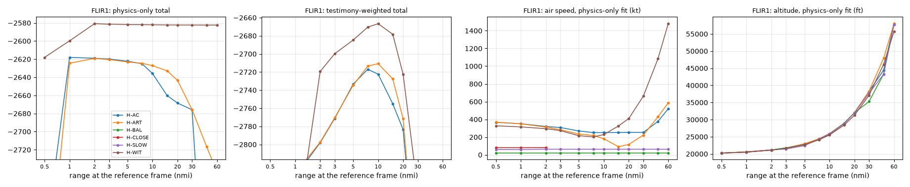

# FLIR1: hypothesis scores (M3)

Generated by `python -m solve.score flir1` then `python -m solve.results_flir1` from `data/derived/flir1_navy/results.json` and `scores.csv`. Design: `docs/design/scoring.md` (binding); the M3 review rules (`docs/results/REVIEW-M3.md`) were applied to FLIR1 as stated there, before any FLIR1 fit.

## In short

- 4 hypotheses in the design table apply to FLIR1 (H-AC, H-ART, H-CLOSE, H-WIT). All 6 were scored the same way; the 2 not listed for FLIR1 are shown separately.
- Testimony-weighted leader (design set): **H-WIT** (Object on a free path (no physical model)), total -2,666.8. Physics-only leader (design set): **H-WIT** (Object on a free path (no physical model)), total -2,582.3.
- H-WIT against H-ART (testimony-weighted fits, per criterion, positive favors H-WIT): image rotation +269, apparent size trend -219, complexity penalty -37, azimuth readout +28.
- H-WIT against H-AC (testimony-weighted fits, per criterion, positive favors H-WIT): image rotation +269, apparent size trend -219, complexity penalty -37, azimuth readout +27.
- H-WIT against H-CLOSE (testimony-weighted fits, per criterion, positive favors H-WIT): azimuth readout +1,714,893, elevation readout +729, brightness trend +116, apparent size trend +60.
- **This leader is conditional on the rotation sigma.** The data-only sigma is 11.86 deg. Rescored at the same best fits, the leader changes from the free-path object to a glare model a little above it: physics-only at 12.8 deg (H-WIT to H-ART); testimony-weighted at 13.0 deg (H-WIT to H-ART).
  Refitted (every hypothesis, full fits, the sigma overridden for the whole case): at 13.00 deg the physics-only leader is H-ART and the testimony-weighted leader H-ART; at 15.65 deg the physics-only leader is H-ART and the testimony-weighted leader H-ART.
  The two-threshold estimate (11.86 deg) is larger than the physical fit's whole held-out residual RMS (8.4 deg; the glare fits' is 15.7 deg). Measurement noise cannot exceed the total residual, so the assumption behind the estimate (the two thresholds' errors are equal and independent) is doubtful here, and so is any ranking that depends on the sigma's exact value. Between the two held-out residual RMS values (8.4 and 15.7 deg) the leader changes, so the FLIR1 ranking of the free path against the glare models rests on which sigma is right, which this data does not settle.
- No range is on screen (the `99.9 RNG` line is a constant placeholder and is not used), so every result below is a best fit along a family of ranges; the range curve near the end shows how speed and altitude trade with range.
- Totals are log-likelihoods after the complexity penalty: higher is better; a difference of 2.3 is a likelihood ratio of 10.

## What was scored

- Frames 0 to 2287 (the whole clip; the azimuth readout is on every frame); reference frame 1145. Azimuth and elevation are compared on the display's 6-frame update frames (381 frames), rounded whole degrees (D-016 convention: round, shared by all).
- Field of view per frame from the on-screen zoom and FOV mode: NAR 0.7 deg at 1.0x, 0.35 deg at 2.0x. Image sizes are converted to px at NAR 1.0x so one scale holds on every frame. The brief MFOV / WFOV stretch (f2169 to f2221, first letter unreadable) is **excluded** from every image series (its field is 3 or 6 deg, unknown which); the angle readouts there are kept.
- Image segments (size and brightness are normalized within each, as the design does per polarity) split at every change of sensor, zoom or FOV mode: f0 to f440 (441 frames, IR, zoom 1.0, NAR); f441 to f526 (86 frames, IR, zoom 2.0, NAR); f539 to f568 (30 frames, TV, zoom 1.0, NAR); f579 to f1239 (653 frames, TV, zoom 2.0, NAR); f1240 to f1273 (34 frames, IR, zoom 2.0, NAR); f1283 to f2087 (334 frames, IR, zoom 1.0, NAR); f2088 to f2141 (54 frames, IR, zoom 2.0, NAR). Segments under 20 frames are not scored.
- Jet: altitude and Mach from the screen, TAS with the ERA5 temperature (mean 338 kt; Sitrec uses 333), turn rate from the horizon-bar bank (g tan(bank) / TAS; no cloud or ocean texture to measure it from). Jet heading, the wind error at the object's altitude and the jet pitch are fitted for every hypothesis (shared nuisance parameters).
- Wind: ERA5 flir1 at 2004-11-14T20:30 UTC (box centre), uncertainty 5.0 kt per component.
- Effective sample sizes (data-only, the same for every hypothesis): Azimuth readout 29, Elevation readout 12, Apparent size trend 640, Brightness trend 591, Image rotation 436; BIC n 1707.
- Not scored: background motion (featureless sky, not measurable), range and closure (not on screen).

## M3 review rules applied to FLIR1

- **Brightness audit (Rule B):** B1 saturation 40 percent of scored frames (limit 50): passes; B2 gain and level adjusted R squared 0.03 (limit 0.5): passes; B3 zoom inside a segment: passes (zoom changes are segment boundaries). Decision: brightness criterion kept with its measured noise.
  - Recorded, not acted on (the rule decides on the whole series): the TV segment's dark blob is clipped to black on almost every frame: f579 to f1239 (100 percent). Its brightness and size there are the clipped area, not the object's signal.
- **Point-spread width (Rule P):** upper bound 1.76 px FWHM (the blob's own half-maximum minor axis on unsaturated frames, px at NAR 1.0x), 3.89 px in the size criterion's metric. GOFAST's point source is not carried over (different recording chain). Symbology line spread 2.66 px (recording chain; drawn strokes are about 2 px wide in this copy, so this is not a tight lower bound).
- **D-016:** blob major axis 11.8 px (median, scored window, px at NAR 1.0x) against 3 x 3.89 = 11.66 px: ratio 3.05, resolved. This is close to the threshold; per segment, the IR 1.0x blob (most IR frames) is not resolved and the 2.0x blobs are.
- **D-017:** saturated on 40 percent of the size criterion's frames (limit 50): size kept.
- Result: every scored criterion carries weight 1 (see the sensitivity table for totals without size and brightness).

## Results table (design set)

Two totals, each at its own best fit: testimony-weighted (testimony weight 1.0) and physics-only (testimony weight 0). Ranks are within the design set.

| Rank (testimony-weighted) | Hypothesis | Testimony-weighted total | Physics-only total | Rank (physics-only) | k | Best-fit range, weighted / physics (nmi) |
|---|---|---|---|---|---|---|
| 1 | H-WIT: Object on a free path (no physical model) | -2,666.8 | -2,582.3 | 1 | 16 | 10.2 / 38.0 |
| 2 | H-ART: Sensor artifact (glare in the pod optics) on a target of any type | -2,710.4 | -2,616.6 | 2 | 6 | 9.2 / 1.1 |
| 3 | H-AC: Distant aircraft (engine exhaust seen as glare) | -2,716.8 | -2,620.6 | 3 | 6 | 7.8 / 3.3 |
| 4 | H-CLOSE: Close small object | -1,718,490.4 (outside the constraint) | -1,718,367.3 (outside the constraint) | 4 | 6 | 2.1 / 2.1 |

Gap to the design-set leader (testimony-weighted / physics-only): H-WIT 0.0 / 0.0; H-ART -43.5 / -34.3; H-AC -50.0 / -38.3; H-CLOSE -1,715,823.6 / -1,715,785.0.

Scored for completeness (not in FLIR1's design row): H-BAL (Balloon drifting with the wind) -2,885.7 / -2,800.5, range 8.9 nmi; H-SLOW (Slow object (bird or small drone)) -1,008,845.6 (outside the constraint) / -1,008,730.9 (outside the constraint), range 2.7 nmi.

### Sensitivity: totals without the size and brightness rows

Both image-trend criteria pass the pre-stated rules on FLIR1, but narrowly (D-016 ratio near 3; the TV segment clipped). This table removes their rows from each fit's totals (the fits are not redone).

| Hypothesis | Weighted total | without size | without size and brightness | Physics-only total | without size | without size and brightness |
|---|---|---|---|---|---|---|
| H-WIT | -2,666.8 | -2,333.0 | -1,842.6 | -2,582.3 | -2,247.5 | -1,756.5 |
| H-ART | -2,710.4 | -2,595.8 | -2,113.4 | -2,616.6 | -2,502.1 | -2,019.3 |
| H-AC | -2,716.8 | -2,602.2 | -2,120.4 | -2,620.6 | -2,506.0 | -2,025.0 |
| H-CLOSE | -1,718,490.4 | -1,718,097.1 | -1,717,490.6 | -1,718,367.3 | -1,717,974.0 | -1,717,367.5 |

### With and without the data-quality exclusions (REVIEW-M3 Rule X)

No data-quality exclusion applies here, so the totals without exclusions are the totals above (every criterion already at its design weight).

## Best-fit object (testimony-weighted fit)

| Hypothesis | Range (nmi, mean) | Altitude (ft, mean; min to max) | Air speed (kt) | Ground speed (kt) | Ground track (deg) | Vertical speed (ft/min) | Jet heading (deg) | Jet pitch (deg) | Wind error E, N (kt) | At a bound |
|---|---|---|---|---|---|---|---|---|---|---|
| H-WIT | 10.23 | 25,797 (24,628 to 28,454) | 235.4 | 183.2 | 87 | -3,062 | 95 | 3.1 | -0.4, -1.1 | anchor_daz_deg |
| H-ART | 9.21 | 25,430 (23,771 to 27,089) | 208.3 | 106.6 | 8 | -2,643 | 33 | 0.0 | 0.3, 0.0 | anchor_daz_deg, anchor_del_deg, jet_pitch_deg |
| H-AC | 7.84 | 24,608 (23,245 to 25,971) | 250.9 | 144.8 | 358 | -2,186 | 18 | 0.0 | -0.1, -7.5 | anchor_daz_deg, anchor_del_deg, jet_pitch_deg, airspeed_kt |
| H-CLOSE | 2.06 | 21,170 (19,947 to 22,393) | 82.2 | 167.1 | 159 | -1,954 | 152 | 3.0 | 20.0, -20.0 | anchor_daz_deg, anchor_del_deg, wind_err_e_kt, wind_err_n_kt, range_ref_nmi, airspeed_kt |
| H-BAL | 8.88 | 24,954 (23,682 to 26,225) | 19.7 | 119.9 | 172 | -2,027 | 227 | 3.8 | 20.0, -20.0 | anchor_daz_deg, wind_err_e_kt, wind_err_n_kt, vz_fpm |
| H-SLOW | 2.72 | 21,303 (20,031 to 22,574) | 63.2 | 149.2 | 162 | -2,029 | 143 | 2.1 | 20.0, -20.0 | anchor_daz_deg, anchor_del_deg, wind_err_e_kt, wind_err_n_kt, airspeed_kt, vz_fpm, altitude constraint (0 to 20,000 ft) |

## Best-fit object (physics-only fit)

| Hypothesis | Range (nmi, mean) | Altitude (ft, mean; min to max) | Air speed (kt) | Ground speed (kt) | Ground track (deg) | Vertical speed (ft/min) | Jet heading (deg) | Jet pitch (deg) | Wind error E, N (kt) | At a bound |
|---|---|---|---|---|---|---|---|---|---|---|
| H-WIT | 37.95 | 42,502 (35,804 to 51,850) | 916.4 | 940.9 | 197 | -11,982 | 347 | 3.8 | -0.1, 0.0 | anchor_daz_deg |
| H-ART | 1.06 | 20,603 (20,581 to 20,626) | 341.6 | 402.8 | 220 | -97 | 226 | 0.0 | -2.4, -5.1 | anchor_daz_deg, jet_pitch_deg |
| H-AC | 3.29 | 21,907 (21,394 to 22,420) | 310.8 | 279.8 | 288 | -860 | 305 | 0.0 | 0.5, -5.2 | anchor_daz_deg, jet_pitch_deg |
| H-CLOSE | 2.06 | 21,170 (19,947 to 22,393) | 82.2 | 167.1 | 159 | -1,954 | 152 | 3.0 | 20.0, -20.0 | anchor_daz_deg, anchor_del_deg, wind_err_e_kt, wind_err_n_kt, range_ref_nmi, airspeed_kt |
| H-BAL | 8.87 | 24,945 (23,673 to 26,217) | 19.7 | 119.9 | 172 | -2,027 | 227 | 3.8 | 20.0, -20.0 | anchor_daz_deg, wind_err_e_kt, wind_err_n_kt, vz_fpm |
| H-SLOW | 2.72 | 21,303 (20,031 to 22,575) | 63.2 | 149.3 | 162 | -2,029 | 143 | 3.9 | 20.0, -20.0 | anchor_daz_deg, anchor_del_deg, wind_err_e_kt, wind_err_n_kt, airspeed_kt, vz_fpm, altitude constraint (0 to 20,000 ft) |

Model parameters (range at the reference frame, airspeed, heading, vertical speed, spline knots) for both fits are in `results.json`.

## Per-criterion log-likelihoods (testimony-weighted fit)

| Criterion | Weight | H-WIT | H-ART | H-AC | H-CLOSE |
|---|---|---|---|---|---|
| Azimuth readout | 1.0 | -108.2 | -136.0 | -135.2 | -1,715,001.1 |
| Elevation readout | 1.0 | -0.4 | -5.2 | -5.9 | -729.8 |
| Apparent size trend | 1.0 | -333.8 | -114.6 | -114.6 | -393.3 |
| Image rotation | 1.0 | -1,590.6 | -1,859.2 | -1,860.0 | -1,590.6 |
| Brightness trend | 1.0 | -490.4 | -482.4 | -481.9 | -606.5 |
| Nuisance priors | 1.0 | -0.1 | -6.6 | -6.6 | -23.5 |
| Complexity penalty | 1.0 | -59.5 | -22.3 | -22.3 | -22.3 |
| Testimony (before weight) | 1.0 | -83.6 | -84.0 | -90.3 | -123.1 |

## Per-criterion log-likelihoods (physics-only fit)

| Criterion | Weight | H-WIT | H-ART | H-AC | H-CLOSE |
|---|---|---|---|---|---|
| Azimuth readout | 1.0 | -106.0 | -141.2 | -137.5 | -1,715,001.1 |
| Elevation readout | 1.0 | -0.4 | -8.2 | -6.2 | -729.8 |
| Apparent size trend | 1.0 | -334.8 | -114.6 | -114.6 | -393.3 |
| Image rotation | 1.0 | -1,590.6 | -1,843.8 | -1,854.8 | -1,590.6 |
| Brightness trend | 1.0 | -491.0 | -482.8 | -481.1 | -606.5 |
| Nuisance priors | 1.0 | -0.0 | -3.8 | -4.1 | -23.6 |
| Complexity penalty | 1.0 | -59.5 | -22.3 | -22.3 | -22.3 |
| Testimony (before weight) | 0.0 | -1,477.8 | -350.0 | -184.2 | -123.1 |

## What the rotation test says

- Measured: the high-threshold blob's major-axis angle on 960 quality-gated frames (elongation at least 1.5, at least 6 px, SNR at least 8, rule stated before the angles were examined); noise 11.9 deg (REVIEW-M3 Rule N, data only: the larger of the two-threshold disagreement, 11.9 deg, and the frame-to-frame scatter, 1.2 deg; the earlier 9-frame running-median value was 7.5 deg); one measurement offset per sensor. Free rotation terms are scored by blocked cross-validation (Rule C, blocks of 3 samples, 5 folds), not counted in k. Over the TV stretch the measured angle stays within -9 to -2 deg (5 to 95 percent).

| Hypothesis | Kind | Fitted terms (knots) | Rotation log-likelihood (held-out) | Terms charged in k | Residual rms, in-sample / held-out (deg) | Predicted turn over the TV stretch (deg) |
|---|---|---|---|---|---|---|
| H-WIT | physical | 18 (16) | -1,590.6 | 0 | 8.0 / 8.4 | 7 |
| H-ART | glare | 3 (1) | -1,859.2 | 0 | 15.6 / 15.6 | 32 |
| H-AC | glare | 3 (1) | -1,860.0 | 0 | 15.6 / 15.7 | 32 |
| H-CLOSE | physical | 18 (16) | -1,590.6 | 0 | 8.0 / 8.4 | 7 |

Rotation noise (REVIEW-M3 Rule N, data only): two-threshold disagreement 11.86 deg, frame-to-frame scatter 1.21 deg, so sigma = 11.86 deg (the earlier running-median value was 7.51 deg). The table rescores the rotation criterion at other sigmas at each fit's own best parameters (not refitted); only the rotation row changes. The grid brackets this case's own sigma by the same rule for every case (fixed 0.88, 1.3, 2.0, 3.0 deg; 0.5, 0.75, 1.1, 1.25, 1.5, 2.0 times the case sigma; smallest and largest held-out residual RMS).

Physics-only total at each sigma (leaders of both totals on the right):

| Sigma (deg) | H-WIT | H-ART | H-AC | H-BAL | H-SLOW | H-CLOSE | Leader, physics-only | Leader, testimony-weighted |
|---|---|---|---|---|---|---|---|---|
| 0.88 | -21,411.6 | -67,165.9 | -69,173.2 | -21,629.8 | -1,027,560.1 (outside the constraint) | -1,737,197.2 (outside the constraint) | H-WIT | H-WIT |
| 1.30 | -10,705.9 | -31,553.1 | -32,469.0 | -10,924.0 | -1,016,854.4 (outside the constraint) | -1,726,491.1 (outside the constraint) | H-WIT | H-WIT |
| 2.00 | -5,581.6 | -14,263.2 | -14,646.0 | -5,799.7 | -1,011,730.2 (outside the constraint) | -1,721,366.7 (outside the constraint) | H-WIT | H-WIT |
| 3.00 | -3,599.4 | -7,336.3 | -7,502.5 | -3,817.5 | -1,009,747.9 (outside the constraint) | -1,719,384.4 (outside the constraint) | H-WIT | H-WIT |
| 5.93 | -2,611.5 | -3,405.1 | -3,442.3 | -2,829.6 | -1,008,760.0 (outside the constraint) | -1,718,396.4 (outside the constraint) | H-WIT | H-WIT |
| 8.44 | -2,541.6 | -2,822.4 | -2,837.2 | -2,759.8 | -1,008,690.2 (outside the constraint) | -1,718,326.6 (outside the constraint) | H-WIT | H-WIT |
| 8.89 | -2,542.8 | -2,773.9 | -2,786.5 | -2,760.9 | -1,008,691.4 (outside the constraint) | -1,718,327.7 (outside the constraint) | H-WIT | H-WIT |
| 11.86 (main) | -2,582.3 | -2,616.6 | -2,620.6 | -2,800.5 | -1,008,730.9 (outside the constraint) | -1,718,367.3 (outside the constraint) | H-WIT | H-WIT |
| 13.05 | -2,604.7 | -2,595.1 | -2,597.2 | -2,822.9 | -1,008,753.3 (outside the constraint) | -1,718,389.7 (outside the constraint) | H-ART | H-ART |
| 14.82 | -2,639.9 | -2,583.1 | -2,583.1 | -2,858.1 | -1,008,788.5 (outside the constraint) | -1,718,424.9 (outside the constraint) | H-AC | H-ART |
| 15.65 | -2,656.3 | -2,582.8 | -2,582.1 | -2,874.4 | -1,008,804.9 (outside the constraint) | -1,718,441.3 (outside the constraint) | H-AC | H-ART |
| 17.79 | -2,697.9 | -2,591.5 | -2,589.3 | -2,916.0 | -1,008,846.4 (outside the constraint) | -1,718,482.8 (outside the constraint) | H-AC | H-ART |
| 23.72 | -2,801.9 | -2,646.4 | -2,642.0 | -3,020.0 | -1,008,950.5 (outside the constraint) | -1,718,586.9 (outside the constraint) | H-AC | H-ART |

Where the leader changes (bisection on the same rescored totals, to 0.01 deg): the physics-only leader changes from H-WIT to H-ART at 12.75 deg, then from H-ART to H-AC at 14.80 deg; the testimony-weighted leader changes from H-WIT to H-ART at 12.96 deg.

Refits at larger sigmas (`tools/sigma_refit.py`, `data/derived/flir1_navy/sigma_refit.json`): every hypothesis refitted through the same fit path with the rotation sigma overridden for the whole case, so these are proper maxima, not rescored values. Testimony-weighted / physics-only totals, rank in brackets (all hypotheses):

| Hypothesis | Main sigma 11.86 deg | Refit at 13.00 deg | Refit at 15.65 deg |
|---|---|---|---|
| H-WIT | -2,666.8 (1) / -2,582.3 (1) | -2,689.0 (2) / -2,603.8 (3) | -2,740.7 (3) / -2,656.1 (3) |
| H-ART | -2,710.4 (2) / -2,616.6 (2) | -2,686.6 (1) / -2,595.4 (1) | -2,668.6 (1) / -2,578.6 (1) |
| H-AC | -2,716.8 (3) / -2,620.6 (3) | -2,692.9 (3) / -2,597.8 (2) | -2,674.6 (2) / -2,581.6 (2) |
| H-BAL | -2,885.7 (4) / -2,800.5 (4) | -2,907.2 (4) / -2,822.0 (4) | -2,959.7 (4) / -2,874.4 (4) |
| H-SLOW | -1,008,845.6 (outside the constraint) (5) / -1,008,730.9 (outside the constraint) (5) | -1,008,866.7 (outside the constraint) (5) / -1,008,752.8 (outside the constraint) (5) | -1,008,919.2 (outside the constraint) (5) / -1,008,804.9 (outside the constraint) (5) |
| H-CLOSE | -1,718,490.4 (outside the constraint) (6) / -1,718,367.3 (outside the constraint) (6) | -1,718,512.4 (outside the constraint) (6) / -1,718,388.8 (outside the constraint) (6) | -1,718,564.8 (outside the constraint) (6) / -1,718,441.2 (outside the constraint) (6) |

- Reading: the pod-derotation glare model (Sitrec's, one free offset) predicts that a glare fixed in the optics turns as the azimuth passes through zero while the pod looks up (el +5 to +6); the best glare fit (H-ART) turns through 32 deg over the TV stretch. The best physical fit (H-WIT, free smooth rotation) is ahead on this criterion by 268.5 log units on held-out data (favors a physical object).
- Stepping pod-roll diagnostic (not in Sitrec, not in any total): the best deadband controller gains 125.2 log units over the smooth derotation after one parameter's penalty.
- Jet-pitch bound (CP-04 review): the glare fits sit at the pitch prior's lower bound (0 deg; prior 3.8 +- 1.5 deg). Lifting the bound (`tools/pitch_check.py`, diagnostic, not in any total): H-AC fitted pitch 0.0 deg; best with the bound lifted -8.00 deg, gaining 108.5 log units (rotation plus the pitch prior, other parameters held); H-ART fitted pitch 0.0 deg; best with the bound lifted -8.00 deg, gaining 108.1 log units (rotation plus the pitch prior, other parameters held). So the bound accounts for at most that much of the 268.5 rotation gap, and only at a pitch far below the prior; the rest of the gap does not depend on it.
- Condition: the glare model is applied to the TV frames as well as the IR frames (a glare in the shared pod optics would derotate the same way in either camera; if the TV camera has separate optics, a glare there would not follow this model). This is an assumption.
- Sitrec's `FLIR1 Glare Angle.csv` (a reference only, not loaded by Sitrec's FLIR1 sitch): 0 deg to f1473, then 135 at f1500 and 245 at f1673 (2007-copy numbering, 1 to 3 frames behind ours). Those frames lie in the IR 1.0x stretch where the blob is faint (median SNR 4) and too round to give an orientation, so none of them passes the quality rule: that keyframed turn cannot be tested on these frames.
- Steps found in the measured series (data only, at least 6 deg): 5: f147 (+13), f216 (-33), f339 (-6), f451 (-1), f1254 (+8).

## Testimony terms

FLIR1 has 18 scorable terms (object altitude, size, ground speed, range; `data/testimony/scorable.yaml`), the same for every hypothesis; firsthand weight 1.0, relayed 0.5; recalled numbers never tighter than 25 percent (D-015). Each cell: predicted value at the testimony-weighted fit, weighted log-likelihood.

| Claim | Quantity | Claimed interval (sigma) | H-WIT | H-ART | H-AC | H-CLOSE |
|---|---|---|---|---|---|---|
| T-T01 | object_altitude_ft | 20,000.0 to 20,000.0 (8,000.0) | 25,374.1, -5.07 | 25,429.9, -5.07 | 24,608.1, -5.04 | 21,169.8, -4.96 |
| T-T13 | object_altitude_ft | 20,000.0 to 20,000.0 (5,000.0) | 25,374.1, -5.01 | 25,429.9, -5.01 | 24,608.1, -4.93 | 21,169.8, -4.73 |
| T-T14 | size_ft | 40.0 to 40.0 (10.0) | 36.4, -3.29 | 35.1, -3.34 | 29.7, -3.75 | 8.9, -8.07 |
| T-T20 | size_ft | 56.0 to 56.0 (15.0) | 36.4, -4.48 | 35.1, -4.60 | 29.7, -5.16 | 8.9, -8.57 |
| T-T28 | size_ft | 30.0 to 40.0 (10.0) | 36.4, -1.64 | 35.1, -1.63 | 29.7, -1.70 | 8.9, -3.21 |
| T-T33 | size_ft | 47.0 to 47.0 (11.8) | 36.4, -3.79 | 35.1, -3.89 | 29.7, -4.47 | 8.9, -8.65 |
| T-T44 | object_altitude_ft | 28,000.0 to 28,000.0 (7,000.0) | 25,374.1, -9.84 | 25,429.9, -9.84 | 24,608.1, -9.89 | 21,169.8, -10.25 |
| T-T44 | ground_speed_kt | 100.0 to 100.0 (25.0) | 106.7, -4.17 | 106.6, -4.17 | 144.8, -5.74 | 167.1, -7.74 |
| T-T57 | size_ft | 40.0 to 40.0 (10.0) | 36.4, -3.29 | 35.1, -3.34 | 29.7, -3.75 | 8.9, -8.07 |
| T-T57 | ground_speed_kt | 120.0 to 120.0 (30.0) | 106.7, -4.42 | 106.6, -4.42 | 144.8, -4.66 | 167.1, -5.55 |
| T-T60 | range_nmi | 8.7 to 13.0 (3.2) | 8.1, -2.47 | 7.3, -2.69 | 6.4, -2.99 | 0.5, -6.65 |
| T-T64 | object_altitude_ft | 25,000.0 to 25,000.0 (6,250.0) | 25,374.1, -4.83 | 25,429.9, -4.83 | 24,608.1, -4.83 | 21,169.8, -4.92 |
| T-T64 | ground_speed_kt | 100.0 to 100.0 (25.0) | 106.7, -2.09 | 106.6, -2.09 | 144.8, -2.87 | 167.1, -3.87 |
| T-T67 | size_ft | 25.0 to 30.0 (7.5) | 36.4, -3.64 | 35.1, -3.45 | 29.7, -2.99 | 8.9, -5.93 |
| T-T71 | size_ft | 45.0 to 45.0 (11.2) | 36.4, -1.81 | 35.1, -1.86 | 29.7, -2.13 | 8.9, -4.25 |
| T-T95 | object_altitude_ft | 20,000.0 to 28,000.0 (7,000.0) | 25,374.1, -9.84 | 25,429.9, -9.84 | 24,608.1, -9.83 | 21,169.8, -9.90 |
| T-T101 | object_altitude_ft | 25,000.0 to 28,000.0 (7,000.0) | 25,374.1, -9.79 | 25,429.9, -9.79 | 24,608.1, -9.82 | 21,169.8, -10.07 |
| T-T101 | ground_speed_kt | 100.0 to 100.0 (25.0) | 106.7, -4.17 | 106.6, -4.17 | 144.8, -5.74 | 167.1, -7.74 |

What the testimony terms do: H-WIT testimony -83.6 at its weighted fit, -1,477.8 at its physics-only fit (range 10.2 vs 38.0 nmi); H-ART testimony -84.0 at its weighted fit, -350.0 at its physics-only fit (range 9.2 vs 1.1 nmi); H-AC testimony -90.3 at its weighted fit, -184.2 at its physics-only fit (range 7.8 vs 3.3 nmi); H-CLOSE testimony -123.1 at its weighted fit, -123.1 at its physics-only fit (range 2.1 vs 2.1 nmi).

### Witness consistency (memory against the record; never in a score)

| Claim | Witness | Quantity | Recalled | Lab reading | Status |
|---|---|---|---|---|---|
| T-T17 | Cmdr. David Fravor | clip_duration_s | about 90 s (a minute and a half) | 76.2667 | agree (tolerance 15 s) |
| T-T53 | Senior Chief Kevin Day | clip_duration_s | about 10 s | 76.2667 | disagree (tolerance 5 s) |
| T-T63 | Ryan Weigelt | clip_duration_s | 8 to 10 min | 76.2667 | disagree (tolerance 60 s) |
| T-T75 | Cmdr. David Fravor | jet_altitude_ft | about 20,000 ft (19,990) | 19990 to 20000 | agree (tolerance 10 ft) |
| T-T75 | Cmdr. David Fravor | jet_speed_kt | 250 kt | 244 to 254 | agree (tolerance 5 kt) |
| T-T76 | Cmdr. David Fravor | jet_speed_kt | 250 kt | 244 to 254 | agree (tolerance 5 kt) |
| T-T77 | Cmdr. David Fravor | display_range_field | range field shows 99.9 | 99.9 1315 fr, blank 973 fr | partial (57% of frames show the recalled value) |
| T-T78 | Lt. Chad Underwood | display_range_field | range field shows 99.9 | 99.9 1315 fr, blank 973 fr | partial (57% of frames show the recalled value) |

## Range curve from the angles alone

A constant-velocity object fitted to the azimuth and elevation readouts only, at each assumed range: the speed and altitude it then needs. This is the range problem FLIR1 cannot remove from its own screen.

| Assumed range (nmi) | Air speed (kt) | Ground speed (kt) | Altitude (ft) | Vertical speed (ft/min) | Line-of-sight log-likelihood |
|---|---|---|---|---|---|
| 0.5 | 381 | 312 | 20,280 | 228 | -155.9 |
| 1.0 | 348 | 387 | 20,555 | 14 | -134.6 |
| 2.0 | 317 | 395 | 21,113 | -319 | -134.0 |
| 5.0 | 253 | 287 | 22,818 | -1,251 | -134.0 |
| 10.0 | 166 | 182 | 25,703 | -2,806 | -134.0 |
| 15.0 | 172 | 96 | 28,629 | -4,312 | -134.0 |
| 20.0 | 160 | 233 | 31,602 | -5,857 | -134.1 |
| 30.0 | 423 | 379 | 37,684 | -8,947 | -134.1 |
| 40.0 | 610 | 675 | 43,941 | -12,035 | -134.1 |
| 60.0 | 1,113 | 1,105 | 56,997 | -18,124 | -134.2 |

## Per-hypothesis curves over range

For each hypothesis, the range at the reference frame is held fixed on a grid and every other parameter is refitted (both totals, with the exclusions, ERA5 winds; fewer random starts than the main fits, so a point can sit slightly below a full fit). Full table: `data/derived/flir1_navy/range_curves.csv`; plot: `docs/results/flir1_range_curves.png`. Below: physics-only total, and the implied air speed (kt) / altitude (ft) / largest acceleration (g) at the physics-only fit; a dash outside the hypothesis's prior.

| Range (nmi) | H-AC | H-ART | H-BAL | H-CLOSE | H-SLOW | H-WIT |
|---|---|---|---|---|---|---|
| 0.5 | -2,826.4; 367 / 20,251 / 0.00 | -2,905.9; 369 / 20,241 / 0.00 | -12,185,500.0 (outside the constraint); 20 / 20,240 / 0.00 | -11,376,300.0 (outside the constraint); 81 / 20,245 / 0.00 | -11,731,000.0 (outside the constraint); 60 / 20,239 / 0.00 | -2,618.0; 328 / 20,264 / 0.08 |
| 1.0 | -2,618.0; 351 / 20,555 / 0.00 | -2,624.5; 350 / 20,583 / 0.00 | -9,928,060.0 (outside the constraint); 20 / 20,517 / 0.00 | -8,220,080.0 (outside the constraint); 81 / 20,584 / 0.00 | -9,031,020.0 (outside the constraint); 60 / 20,478 / 0.00 | -2,599.8; 315 / 20,536 / 0.17 |
| 2.0 | -2,619.0; 320 / 21,156 / 0.00 | -2,619.2; 313 / 21,141 / 0.00 | -5,265,040.0 (outside the constraint); 20 / 21,170 / 0.00 | -1,718,370.0 (outside the constraint); 82 / 21,170 / 0.00 | -3,845,790.0 (outside the constraint); 63 / 21,170 / 0.00 | -2,580.9; 295 / 21,077 / 0.32 |
| 3.0 | -2,619.8; 308 / 21,740 / 0.00 | -2,620.4; 283 / 21,733 / 0.00 | -537,596.0 (outside the constraint); 20 / 21,757 / 0.00 | - | -1,020,020.0 (outside the constraint); 63 / 21,440 / 0.00 | -2,581.4; 273 / 21,624 / 0.50 |
| 5.0 | -2,622.3; 270 / 22,925 / 0.00 | -2,623.1; 235 / 22,919 / 0.00 | -3,678.7; 20 / 22,625 / 0.00 | - | -1,648,900.0 (outside the constraint); 63 / 22,407 / 0.00 | -2,581.8; 216 / 22,751 / 0.86 |
| 7.5 | -2,625.2; 251 / 24,419 / 0.00 | -2,624.6; 218 / 24,416 / 0.00 | -2,856.9; 20 / 24,163 / 0.00 | - | -2,002,650.0 (outside the constraint); 63 / 24,340 / 0.00 | -2,582.0; 203 / 24,122 / 1.32 |
| 10.0 | -2,635.9; 251 / 25,913 / 0.00 | -2,627.2; 182 / 25,913 / 0.00 | -2,839.3; 20 / 25,649 / 0.00 | - | -2,002,610.0 (outside the constraint); 63 / 25,810 / 0.00 | -2,582.1; 229 / 25,518 / 1.77 |
| 15.0 | -2,660.2; 252 / 28,935 / 0.00 | -2,632.9; 92 / 28,935 / 0.00 | -3,872.0; 20 / 28,934 / 0.00 | - | -2,002,620.0 (outside the constraint); 63 / 28,773 / 0.00 | -2,582.2; 325 / 28,398 / 2.67 |
| 20.0 | -2,668.4; 253 / 32,000 / 0.00 | -2,643.3; 117 / 32,000 / 0.00 | -4,937.7; 20 / 31,998 / 0.00 | - | -2,002,820.0 (outside the constraint); 63 / 31,909 / 0.00 | -2,582.3; 409 / 31,241 / 3.58 |
| 30.0 | -2,675.9; 253 / 38,257 / 0.00 | -2,675.9; 223 / 38,257 / 0.00 | -6,945.8; 20 / 35,271 / 0.00 | - | -2,004,370.0 (outside the constraint); 63 / 37,706 / 0.00 | -2,582.3; 662 / 37,095 / 5.37 |
| 45.0 | -2,929.7; 377 / 44,420 / 0.00 | -2,716.7; 429 / 47,937 / 0.00 | -9,805.6; 20 / 43,228 / 0.00 | - | -2,007,270.0 (outside the constraint); 63 / 43,228 / 0.00 | -2,582.3; 1,084 / 46,150 / 8.06 |
| 60.0 | -2,002,750.0 (outside the constraint); 521 / 58,087 / 0.00 | -2,745.0; 588 / 58,024 / 0.00 | -11,138.1; 20 / 57,744 / 0.00 | - | -2,008,950.0 (outside the constraint); 63 / 57,775 / 0.00 | -2,582.4; 1,483 / 55,685 / 10.75 |

Grid points within 2.3 log units of each hypothesis's best physics-only point: H-AC the points 1.00, 2.00, 3.00 nmi; H-ART the points 2.00, 3.00 nmi; H-BAL only the 10.00 nmi point (its neighbours on the grid are more than 2.3 lower, so the peak is narrower than the grid spacing); H-CLOSE only the 2.00 nmi point (its neighbours on the grid are more than 2.3 lower, so the peak is narrower than the grid spacing); H-SLOW only the 3.00 nmi point (its neighbours on the grid are more than 2.3 lower, so the peak is narrower than the grid spacing); H-WIT the points 2.00, 3.00, 5.00, 7.50, 10.00, 15.00, 20.00, 30.00, 45.00, 60.00 nmi.

Optimizer shortfall: some range-curve points score above the main fit even though they use fewer random starts, so those main fits stopped short of their optimum by up to 2.6 log units: H-AC physics-only -2,618.0 at 1.00 nmi against -2,620.6 (+2.6); H-CLOSE testimony-weighted -1,718,490.0 at 2.00 nmi against -1,718,490.4 (+0.4); H-WIT physics-only -2,580.9 at 2.00 nmi against -2,582.3 (+1.5); H-WIT testimony-weighted -2,666.7 at 10.00 nmi against -2,666.8 (+0.2). The main-fit totals in the tables above are as fitted. Taking the better of the two for every hypothesis, the physics-only leader stays H-WIT and the testimony-weighted leader stays H-WIT.

Cells marked "outside the constraint" are dominated by a term at the likelihood floor (a hard constraint such as an altitude limit, or a readout far outside its interval); their size is the floor, not a likelihood.

## Checks reported, not scored

Implied size is the blob's length (px at NAR 1.0x) times the range: an upper bound, because the blob includes the optics' blur and, in TV, clipping.

| Hypothesis | Implied size, upper bound (m) | Expected (m) | Inside? |
|---|---|---|---|
| H-WIT | 11.22 | 0.0 to 1000.0 | yes |
| H-ART | 10.10 | 0.0 to 1000.0 | yes |
| H-AC | 8.59 | 0.0 to 1000.0 | yes |
| H-CLOSE | 2.20 | 0.1 to 2.0 | no |

## Which hypotheses this data can separate

- Model recovery (M3.4, `docs/results/recovery.md`): synthetic data from each hypothesis, scored by the same path (physics-only total). Rows: the hypothesis that made the data; columns: how often each hypothesis won.

| Data made by | H-AC | H-ART | H-CLOSE | H-WIT | data sets |
|---|---|---|---|---|---|
| H-AC | 0 | 3 | 0 | 0 | 3 |
| H-ART | 0 | 3 | 0 | 0 | 3 |
| H-CLOSE | 0 | 0 | 2 | 1 | 3 |
| H-WIT | 0 | 0 | 0 | 3 | 3 |

- Run on the four design-set hypotheses only (generators and fitted), three parameter sets each, one noise draw: a modest test (`python -m solve.recovery flir1 "" --design-set --procs 4`). Full tables in `docs/results/recovery.md`.
- Optimizer failure, not a separation: on the best set made by H-CLOSE, its own fit ended 58,710 log units below its total at the true parameters, so that cell's winner says nothing about separability.
- Reading: data made by a glare model (H-AC, H-ART) were always won by a glare model, and data made by a physical model (H-CLOSE, H-WIT) by a physical model (the rotation and size criteria separate the two groups); H-AC and H-ART share one physical model here and differ only by priors, so they are not separated.

## Assumptions and conditions

- Field of view: NAR 0.7 deg at 1.0x and 0.35 deg at 2.0x, as the brief and Sitrec's FOV table use (the GIMBAL dispute over NAR 2.0 is not repeated here); the TV camera is assumed to share the IR camera's NAR field.
- The MFOV / WFOV stretch (f2169 to f2221) is excluded from the image series, not run both ways.
- Picture width 244 px (active columns of the 352 x 264 copy); pixel aspect taken as 1.0 (not measured on this copy).
- Display rounding: round (a signed zero, 0L, is displayed). The azimuth readout steps from 1R to 1L at f1039 with no zero between, which no smooth sight line produces under either convention; every hypothesis pays for it equally.
- Turn rate from the horizon-bar bank (g tan(bank) / TAS); no turn-rate nuisance. Jet heading free (Sitrec's 227 deg is not a reading).
- Time 11/14/2004 20:30Z and place 31.205 N, 117.870 W (Sitrec), ERA5 winds at that time and box centre; wind error 5 kt per component as a shared nuisance.
- Jet pitch: nuisance, normal 3.8 +- 1.5 deg (Sitrec's angle of attack), scaled by 1/cos(bank) as on GIMBAL; it enters only the rotation criterion.
- Rotation quality rule (elongation, area, SNR thresholds) and the glare model applied in both cameras: see the rotation section.
- Size and brightness segments split at sensor, zoom and FOV-mode changes (an extension of the design's per-polarity normalization; it is what makes Rule B3 pass).
- Testimony: the claims in `data/testimony/flir1.yaml` as mapped in `scorable.yaml`; claims about the first encounter (the merge an hour earlier) are context only.

## How to read this, and its limits

- Likelihoods, not verdicts. No prior probability is put on any class of explanation.
- The image-trend criteria have large n_eff (hundreds of frames) next to the line of sight (tens), so they move totals most; their rows are shown so any weighting can be re-applied.
- Physics-only fit before the complexity penalty: H-WIT -2,522.8; H-ART -2,594.3; H-AC -2,598.3; H-CLOSE -1,718,345.0.
- BIC counts parameters, not prior width: a wide prior costs nothing extra.
- Discriminators for the top pair (M3.6) are written separately (`docs/results/discriminators.md`).

