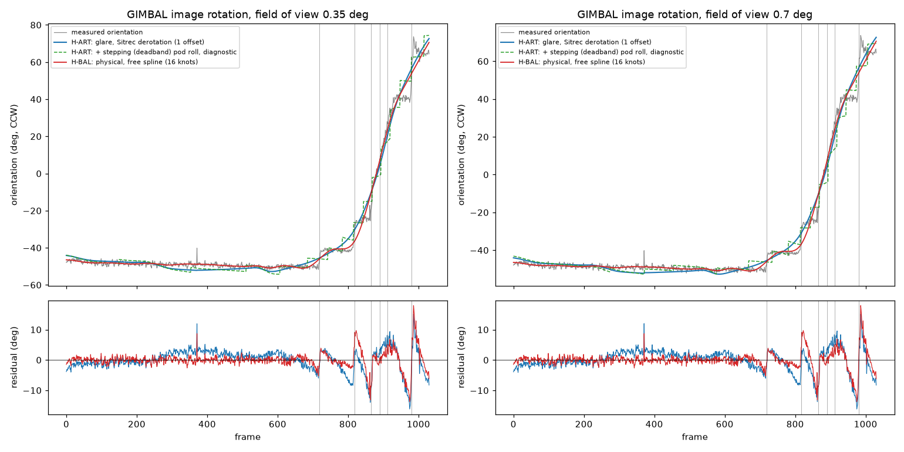

# GIMBAL: hypothesis scores (M3.5)

Generated by `python -m solve.score gimbal` (one run per field of view) then `python -m solve.results_report gimbal` from `data/derived/gimbal/results.json` and `scores.csv`. Design: `docs/design/scoring.md` (binding). Nothing on this page is a verdict about what the object was: these are likelihoods under stated conditions.

**Status flags (read first):**

- At 0.35 deg: D-016: apparent-size criterion reported with weight 0 (blob major axis 24.6 px is under 3 x the point-spread width 9.8 px); resolution not established.
- REVIEW-M3 Rule B: brightness criterion reported with weight 0 (B1 saturation: blob saturated on 64 percent of scored frames, gain and level explain 14 percent of its variance); not range-informative.
- At 0.7 deg: D-017: apparent-size criterion reported with weight 0 (resolved, but the blob is saturated on 64 percent of its scored frames, over the 50 percent limit of Rule B1); size is clipped, not range-informative.
- Testimony: solve/testimony.py: 9 claim terms scored.
- Field of view is a sensor setting, not a hypothesis parameter: every hypothesis is scored at 0.35 deg and again at 0.7 deg, and the two runs are reported side by side, never mixed.
- Review: the four M3 review items (brightness audit, equal range priors, ERA5 turn rate, point-spread width) are resolved in `docs/results/REVIEW-M3.md`; which hypotheses this data can separate at all is in `docs/results/recovery.md`.

## What was scored

- Frames 0 to 1030 (all of them: the object is found on every frame); reference frame 513.
- Every hypothesis was fitted by the same code (maximum likelihood within its prior bounds, multi-start), against the same observables, with the same noise model and weights (`solve/scoring.yaml`). Hypotheses differ only in their physical model and priors (`solve/hypotheses/*.yaml`).
- Shared nuisance parameters, fitted for every hypothesis: the jet's starting heading (not on screen), the wind error at the object's altitude, the sight-line offsets inside the whole-degree readouts, the jet's turn-rate offset inside its measured band, and the jet's pitch (which only moves the pod roll and image horizon).
- Jet turn rate: the lab's own cloud-derived history (`docs/reproductions/gimbal_turn_rate.md`), recomputed with ERA5 winds and temperature (REVIEW-M3 item 3) and re-derived from the same cloud measurement at each field of view: total heading change -65.1 deg at 0.35 deg, -68.6 deg at 0.7 deg; median 1-sigma band 0.022 deg/s, 0.023 deg/s. The cloud motion enters once, as the band's Gaussian on the turn-rate offset (the "cloud motion" row).
- Display rounding (D-016, shared): the readout rounds (fitted once from the azimuth readout's hold times).
- Effective sample sizes (from the data's own autocorrelation, the same for every hypothesis): Azimuth readout 16, Elevation readout 7, Apparent size trend 60, Brightness trend 254, Image rotation 23; total of the criteria in the totals (the BIC n): 45 at 0.35 deg, 45 at 0.7 deg.
- Image rotation: the measured orientation of the blob's major axis on all 1,031 frames, noise 0.88 deg (scatter about a 9-frame running median). A glare model predicts it from the pod geometry with ONE free offset (Sitrec's glare start angle); a physical model gets a free smooth rotation (a spline whose knot count the data choose, each knot charged 0.5 ln(n_eff) like any parameter). Both get one shared offset for the black-hot segment.
- Log-likelihoods: higher is better. A difference of 2.3 is a likelihood ratio of 10. Totals include a complexity penalty of 0.5 k ln(n_eff) for k free parameters.

## Results: both totals at both fields of view

Each total is at its own best fit: testimony-weighted (testimony weight 1.0) and physics-only (testimony weight 0). Rank in brackets.

| Hypothesis | 0.35 deg testimony-weighted | 0.35 deg physics-only | 0.7 deg testimony-weighted | 0.7 deg physics-only | k |
|---|---|---|---|---|---|
| H-WIT: Object on a free path (no physical model) | -191.8 (1) | -168.9 (3) | -193.1 (1) | -168.9 (3) | 49 |
| H-BAL: Balloon drifting with the wind | -208.6 (2) | -146.1 (1) | -202.2 (2) | -146.7 (1) | 37 |
| H-SLOW: Slow object (bird or small drone) | -219.0 (3) | -149.8 (2) | -224.9 (3) | -158.1 (2) | 39 |
| H-ART: Sensor artifact (glare in the pod optics) on a target of any type | -285.5 (4) | -225.2 (4) | -275.8 (4) | -225.4 (4) | 8 |
| H-AC: Distant aircraft (engine exhaust seen as glare) | -308.8 (5) | -225.2 (5) | -299.0 (5) | -225.4 (5) | 8 |
| H-CLOSE: Close small object | -14,667.7 (6) | -14,617.7 (6) | -11,484.8 (6) | -11,434.2 (6) | 39 |

k counts every free parameter, including the rotation criterion's own free terms (so a physical model's k includes its rotation spline). All six hypotheses are in the design set for GIMBAL.

At 0.35 deg: gap to the leader (H-WIT testimony-weighted, H-BAL physics-only): H-BAL -16.9 / 0.0; H-SLOW -27.2 / -3.8; H-ART -93.7 / -79.2; H-AC -117.0 / -79.2; H-CLOSE -14,475.9 / -14,471.7.

At 0.7 deg: gap to the leader (H-WIT testimony-weighted, H-BAL physics-only): H-BAL -9.1 / 0.0; H-SLOW -31.8 / -11.3; H-ART -82.7 / -78.6; H-AC -105.9 / -78.6; H-CLOSE -11,291.8 / -11,287.5.

## Best-fit object

Range is free for every hypothesis (within its prior), so it is a fitted result here, not an input. Values are means over the clip; "stop/reverse" says whether the fitted ground velocity reverses direction.

### 0.35 deg field of view

| Hypothesis | Fit | Range (nmi) | Altitude (ft) | Air speed (kt) | Ground speed (kt, min) | Ground track (deg) | Vertical speed (ft/min) | Stop/reverse | Jet heading (deg) | Turn-rate offset (sigma) | Jet pitch (deg) | Params at a prior bound |
|---|---|---|---|---|---|---|---|---|---|---|---|---|
| H-WIT | testimony-weighted | 9.7 | 23,167 | 126 | 60 (5) | 326 | 782 | yes | 312 | -1.83 | 3.9 | none |
| H-WIT | physics-only | 59.8 | 15,593 | 633 | 695 (349) | 59 | -1,982 | no | 143 | -0.01 | 3.6 | range_ref_nmi |
| H-BAL | testimony-weighted | 15.7 | 21,680 | 0 | 82 (82) | 75 | 51 | no | 241 | -0.42 | 3.6 | none |
| H-BAL | physics-only | 22.8 | 20,522 | 0 | 83 (83) | 74 | -46 | no | 88 | 0.20 | 3.6 | none |
| H-SLOW | testimony-weighted | 21.3 | 19,997 | 48 | 33 (33) | 77 | 20 | no | 334 | -0.02 | 3.6 | altitude constraint (0 to 20,000 ft) |
| H-SLOW | physics-only | 24.8 | 19,995 | 60 | 52 (52) | 28 | -20 | no | 22 | -0.01 | 3.6 | airspeed_kt, altitude constraint (0 to 20,000 ft) |
| H-ART | testimony-weighted | 16.5 | 21,253 | 104 | 19 (19) | 264 | 869 | no | 138 | -0.28 | 3.3 | none |
| H-ART | physics-only | 41.0 | 16,415 | 573 | 558 (558) | 339 | -710 | no | 48 | -0.13 | 3.1 | none |
| H-AC | testimony-weighted | 15.6 | 21,622 | 250 | 156 (156) | 255 | 854 | no | 134 | -0.61 | 3.3 | airspeed_kt |
| H-AC | physics-only | 39.3 | 16,702 | 508 | 577 (577) | 61 | -652 | no | 137 | -0.12 | 3.1 | none |
| H-CLOSE | testimony-weighted | 1.9 | 24,685 | 80 | 21 (21) | 125 | 723 | no | 246 | -4.00 | 3.9 | anchor_daz_deg, turn_rate_z, range_ref_nmi, airspeed_kt |
| H-CLOSE | physics-only | 1.9 | 24,684 | 80 | 142 (142) | 47 | 737 | no | 0 | -4.00 | 3.6 | anchor_daz_deg, turn_rate_z, range_ref_nmi, airspeed_kt |

### 0.7 deg field of view

| Hypothesis | Fit | Range (nmi) | Altitude (ft) | Air speed (kt) | Ground speed (kt, min) | Ground track (deg) | Vertical speed (ft/min) | Stop/reverse | Jet heading (deg) | Turn-rate offset (sigma) | Jet pitch (deg) | Params at a prior bound |
|---|---|---|---|---|---|---|---|---|---|---|---|---|
| H-WIT | testimony-weighted | 12.9 | 22,616 | 129 | 53 (12) | 288 | -459 | yes | 356 | -1.34 | 4.1 | none |
| H-WIT | physics-only | 59.1 | 16,016 | 844 | 863 (480) | 26 | -1,476 | no | 157 | -0.02 | 3.6 | range_ref_nmi |
| H-BAL | testimony-weighted | 11.8 | 22,547 | 0 | 85 (85) | 78 | 16 | no | 93 | 0.24 | 3.6 | none |
| H-BAL | physics-only | 12.5 | 22,443 | 0 | 88 (88) | 77 | -11 | no | 90 | 0.77 | 3.6 | none |
| H-SLOW | testimony-weighted | 20.9 | 19,997 | 60 | 23 (23) | 44 | -9 | no | 45 | 2.12 | 3.9 | airspeed_kt, altitude constraint (0 to 20,000 ft) |
| H-SLOW | physics-only | 21.8 | 19,997 | 60 | 54 (54) | 26 | -36 | no | 73 | 2.36 | 3.6 | airspeed_kt, altitude constraint (0 to 20,000 ft) |
| H-ART | testimony-weighted | 12.6 | 22,111 | 104 | 16 (16) | 265 | 946 | no | 118 | -0.22 | 3.2 | none |
| H-ART | physics-only | 21.8 | 20,080 | 437 | 396 (396) | 319 | -313 | no | 31 | -0.12 | 3.1 | none |
| H-AC | testimony-weighted | 11.5 | 22,559 | 250 | 152 (152) | 258 | 895 | no | 132 | -0.36 | 3.2 | airspeed_kt |
| H-AC | physics-only | 21.8 | 20,085 | 439 | 370 (370) | 291 | -305 | no | 7 | -0.11 | 3.1 | none |
| H-CLOSE | testimony-weighted | 1.9 | 24,684 | 66 | 29 (29) | 78 | 770 | no | 252 | -4.00 | 4.4 | anchor_daz_deg, turn_rate_z, range_ref_nmi |
| H-CLOSE | physics-only | 1.9 | 24,682 | 70 | 136 (136) | 54 | 779 | no | 360 | -4.00 | 3.4 | anchor_daz_deg, turn_rate_z, range_ref_nmi |

All fitted parameters (both fits, both fields of view) are in `results.json`.

## Per-criterion log-likelihoods (testimony-weighted fit)

### 0.35 deg

| Criterion | Weight | H-WIT | H-BAL | H-SLOW | H-ART | H-AC | H-CLOSE |
|---|---|---|---|---|---|---|---|
| Azimuth readout | 1.0 | -2.1 | -4.6 | -1.7 | -10.5 | -10.6 | -14,459.3 |
| Elevation readout | 1.0 | -0.0 | -0.0 | -1.9 | -0.3 | -0.2 | -1.6 |
| Apparent size trend (weight 0) | 0.0 | -39.1 | -21.4 | 28.4 | 121.5 | 121.5 | -4,599.4 |
| Image rotation | 1.0 | -73.9 | -73.9 | -73.9 | -205.6 | -205.9 | -73.8 |
| Brightness trend (weight 0) | 0.0 | -96.4 | -49.7 | 100.6 | -165.4 | -437.1 | -13,770.6 |
| Cloud motion (turn-rate band) | 1.0 | -1.7 | -0.1 | -0.0 | -0.0 | -0.2 | -8.0 |
| Nuisance priors | 1.0 | -0.0 | -0.3 | -0.1 | -0.4 | -1.8 | -1.2 |
| Complexity penalty | 1.0 | -93.5 | -70.6 | -74.4 | -15.3 | -15.3 | -74.4 |
| Testimony (before weight) | 1.0 | -20.5 | -59.1 | -67.0 | -53.4 | -74.8 | -49.4 |

- Apparent size trend at 0.35 deg: shown but weight 0 (D-016: the blob is not resolved against the point-spread width measured on this video (REVIEW-M3 item 4)), so it enters no total.
- Brightness trend at 0.35 deg: shown but weight 0 (REVIEW-M3 Rule B: the blob is saturated, so its integrated contrast is not range-informative), so it enters no total.

### 0.7 deg

| Criterion | Weight | H-WIT | H-BAL | H-SLOW | H-ART | H-AC | H-CLOSE |
|---|---|---|---|---|---|---|---|
| Azimuth readout | 1.0 | -1.8 | -2.3 | -5.1 | -7.4 | -8.0 | -11,276.0 |
| Elevation readout | 1.0 | -0.1 | -0.0 | -3.3 | -0.3 | -0.2 | -1.4 |
| Apparent size trend (weight 0) | 0.0 | 11.2 | -70.9 | 18.0 | 121.5 | 121.5 | -5,500.2 |
| Image rotation | 1.0 | -73.9 | -73.9 | -73.9 | -204.1 | -204.5 | -73.8 |
| Brightness trend (weight 0) | 0.0 | 56.9 | -198.1 | 68.5 | -349.4 | -892.3 | -16,481.1 |
| Cloud motion (turn-rate band) | 1.0 | -0.9 | -0.0 | -2.2 | -0.0 | -0.1 | -8.0 |
| Nuisance priors | 1.0 | -0.2 | -0.3 | -0.3 | -0.5 | -1.9 | -1.4 |
| Complexity penalty | 1.0 | -93.5 | -70.6 | -74.4 | -15.3 | -15.3 | -74.4 |
| Testimony (before weight) | 1.0 | -22.7 | -55.0 | -65.5 | -48.2 | -69.0 | -49.8 |

- Apparent size trend at 0.7 deg: shown but weight 0 (D-017: the blob is resolved but saturated (Rule B1 saturation flag), so its size is clipped, not range-informative), so it enters no total.
- Brightness trend at 0.7 deg: shown but weight 0 (REVIEW-M3 Rule B: the blob is saturated, so its integrated contrast is not range-informative), so it enters no total.

### Sensitivity: weight-0 criteria added back

Criteria that fail a data-quality test are reported but kept out of every total. For transparency, this table adds each one back at weight 1 to the testimony-weighted fit's totals (the fit itself is not redone, so a refit could only raise these numbers).

0.35 deg: Apparent size trend: D-016: the blob is not resolved against the point-spread width measured on this video (REVIEW-M3 item 4); Brightness trend: REVIEW-M3 Rule B: the blob is saturated, so its integrated contrast is not range-informative.

| Hypothesis | + Apparent size trend: weighted / physics | + Brightness trend: weighted / physics | + all: weighted / physics |
|---|---|---|---|
| H-WIT | -230.9 / -210.4 | -288.2 / -267.7 | -327.2 / -306.8 |
| H-BAL | -230.0 / -170.9 | -258.3 / -199.2 | -279.7 / -220.6 |
| H-SLOW | -190.6 / -123.6 | -118.4 / -51.4 | -90.0 / -23.0 |
| H-ART | -164.0 / -110.6 | -450.9 / -397.5 | -329.4 / -276.0 |
| H-AC | -187.3 / -112.5 | -745.9 / -671.1 | -624.5 / -549.6 |
| H-CLOSE | -19,267.1 / -19,217.6 | -28,438.3 / -28,388.8 | -33,037.6 / -32,988.2 |

0.7 deg: Apparent size trend: D-017: the blob is resolved but saturated (Rule B1 saturation flag), so its size is clipped, not range-informative; Brightness trend: REVIEW-M3 Rule B: the blob is saturated, so its integrated contrast is not range-informative.

| Hypothesis | + Apparent size trend: weighted / physics | + Brightness trend: weighted / physics | + all: weighted / physics |
|---|---|---|---|
| H-WIT | -181.9 / -159.2 | -136.2 / -113.5 | -125.0 / -102.3 |
| H-BAL | -273.1 / -218.1 | -400.2 / -345.3 | -471.2 / -416.2 |
| H-SLOW | -206.8 / -141.3 | -156.3 / -90.8 | -138.3 / -72.8 |
| H-ART | -154.3 / -106.1 | -625.2 / -577.0 | -503.7 / -455.5 |
| H-AC | -177.5 / -108.5 | -1,191.2 / -1,122.2 | -1,069.8 / -1,000.8 |
| H-CLOSE | -16,985.1 / -16,935.3 | -27,965.9 / -27,916.1 | -33,466.1 / -33,416.3 |

## The rotation test

### 0.35 deg

| Hypothesis | Kind | Free rotation terms | Rotation log-likelihood | After its own penalty | Residual RMS (deg) | Largest residual (deg) | Glare offset (deg) |
|---|---|---|---|---|---|---|---|
| H-CLOSE | physical | 33 (32 model + shared) | -73.8 | -136.8 | 1.96 | 14.9 | n/a |
| H-BAL | physical | 33 (32 model + shared) | -73.9 | -136.9 | 1.96 | 14.9 | n/a |
| H-SLOW | physical | 33 (32 model + shared) | -73.9 | -136.9 | 1.96 | 14.9 | n/a |
| H-WIT | physical | 33 (32 model + shared) | -73.9 | -136.9 | 1.96 | 14.9 | n/a |
| H-ART | glare | 2 (1 model + shared) | -205.6 | -209.4 | 3.59 | 16.3 | 56.5 |
| H-AC | glare | 2 (1 model + shared) | -205.9 | -209.7 | 3.59 | 16.3 | 56.7 |

Measured steps (found from the orientation series alone, no model): f719 (9 deg), f818 (15 deg), f866 (22 deg), f891 (17 deg), f912 (16 deg), f981 (28 deg). The findings log lists window centres 728, 824, 877, 908 and 974 from the extraction's own step finder; f866 to f920 is a fast continuous turn rather than a clean step, which this finder splits.

Residual jump left at each step (mean residual 5 to 20 frames after minus 5 to 20 before; 0 means the model reproduces the step):

| Step frame | Measured change (deg) | H-ART glare, smooth derotation | H-CLOSE physical spline |
|---|---|---|---|
| 719 | 8.6 | 6.6 | 2.3 |
| 818 | 15.0 | 7.9 | 4.3 |
| 866 | 22.0 | 9.8 | 7.3 |
| 891 | 16.7 | 3.0 | -6.1 |
| 912 | 15.7 | 1.3 | -0.0 |
| 981 | 28.1 | 18.6 | 8.4 |

Step timing (diagnostic, not in any total). Sitrec's model as specified has a smooth pod roll, so it predicts no steps. To test whether steps follow from the geometry, the pod roll was held by a deadband controller (it stays put until the error exceeds a threshold, then jumps; one extra parameter, not in Sitrec), scanned over its threshold, two error measures (pointing error = sin(ball pitch) x roll error, or roll error itself) and with or without re-centring past the target, on H-ART's best-fit sight line. The best setting overall (pointing, threshold 0.4) makes 45 small steps from f569 on, i.e. it tracks almost continuously, and changes the rotation score by 1.1 after its penalty.

Restricted to settings that make about as many steps as were measured (between half and twice as many from f569 on), the best is pointing, re-centring, threshold 0.8: predicted pod-roll steps at f608, f686, f744, f785, f817, f844, f869, f894, f920, f948, f980, f1016. 5 of the 6 measured steps have a predicted step within 10 frames (nearest: f719 to f744 (+25), f818 to f817 (-1), f866 to f869 (+3), f891 to f894 (+3), f912 to f920 (+8), f981 to f980 (-1)); 7 predicted steps have no measured counterpart. Rotation log-likelihood -239.0 against -205.6 for the smooth derotation (residual RMS 3.90 deg); change after one parameter's penalty -35.3.

Against the findings-log step frames (728, 824, 877, 908, 974): nearest predicted step f728: f744 (+16), f824: f817 (-7), f877: f869 (-8), f908: f920 (+12), f974: f980 (+6).

Best of each controller variant (any step count): pointing threshold 0.4: log-likelihood -202.6; pointing_reflect threshold 0.1: log-likelihood -207.0; roll threshold 1.0: log-likelihood -207.3; roll_reflect threshold 1.0: log-likelihood -210.6.

**In plain words (0.35 deg):** Sitrec's glare model, the pod geometry with one fitted offset, reproduces the overall sweep of the image rotation (residual RMS 3.6 deg; fitted offset 56.5 deg, against Sitrec's own starting value of 57.7 deg). With the pod roll following the geometry its rotation is smooth, so it leaves residual jumps of up to 19 deg at the measured step frames. A physical object given a free smooth rotation fits with residual RMS 2.0 deg using 32 knots. After each pays for its own free terms, the free physical rotation scores better on this criterion by 72.6 log units. Making the pod roll step (a deadband controller, one extra parameter, tuned to make about the measured number of steps) puts a predicted step within 10 frames of 5 of the 6 measured steps, with 7 predicted steps that have no measured counterpart, and changes the rotation score by -35.3 after its penalty, which does not close the gap to the free physical rotation. So on this criterion alone the rotation does not single out a glare fixed in the optics: what the glare model gets right is the size and direction of the total turn and the fast turn near the azimuth crossing, and what it misses is the step timing.

### 0.7 deg

| Hypothesis | Kind | Free rotation terms | Rotation log-likelihood | After its own penalty | Residual RMS (deg) | Largest residual (deg) | Glare offset (deg) |
|---|---|---|---|---|---|---|---|
| H-CLOSE | physical | 33 (32 model + shared) | -73.8 | -136.8 | 1.96 | 14.9 | n/a |
| H-BAL | physical | 33 (32 model + shared) | -73.9 | -136.9 | 1.96 | 14.9 | n/a |
| H-SLOW | physical | 33 (32 model + shared) | -73.9 | -136.9 | 1.96 | 14.9 | n/a |
| H-WIT | physical | 33 (32 model + shared) | -73.9 | -136.9 | 1.96 | 14.9 | n/a |
| H-ART | glare | 2 (1 model + shared) | -204.1 | -207.9 | 3.58 | 16.3 | 56.6 |
| H-AC | glare | 2 (1 model + shared) | -204.5 | -208.3 | 3.58 | 16.3 | 56.8 |

Measured steps (found from the orientation series alone, no model): f719 (9 deg), f818 (15 deg), f866 (22 deg), f891 (17 deg), f912 (16 deg), f981 (28 deg). The findings log lists window centres 728, 824, 877, 908 and 974 from the extraction's own step finder; f866 to f920 is a fast continuous turn rather than a clean step, which this finder splits.

Residual jump left at each step (mean residual 5 to 20 frames after minus 5 to 20 before; 0 means the model reproduces the step):

| Step frame | Measured change (deg) | H-ART glare, smooth derotation | H-CLOSE physical spline |
|---|---|---|---|
| 719 | 8.6 | 6.7 | 2.3 |
| 818 | 15.0 | 7.9 | 4.3 |
| 866 | 22.0 | 9.8 | 7.3 |
| 891 | 16.7 | 3.0 | -6.1 |
| 912 | 15.7 | 1.3 | -0.0 |
| 981 | 28.1 | 18.6 | 8.4 |

Step timing (diagnostic, not in any total). Sitrec's model as specified has a smooth pod roll, so it predicts no steps. To test whether steps follow from the geometry, the pod roll was held by a deadband controller (it stays put until the error exceeds a threshold, then jumps; one extra parameter, not in Sitrec), scanned over its threshold, two error measures (pointing error = sin(ball pitch) x roll error, or roll error itself) and with or without re-centring past the target, on H-ART's best-fit sight line. The best setting overall (pointing, threshold 0.3) makes 59 small steps from f569 on, i.e. it tracks almost continuously, and changes the rotation score by 1.3 after its penalty.

Restricted to settings that make about as many steps as were measured (between half and twice as many from f569 on), the best is pointing, re-centring, threshold 0.8: predicted pod-roll steps at f610, f688, f746, f787, f819, f847, f872, f897, f923, f952, f985, f1023. 4 of the 6 measured steps have a predicted step within 10 frames (nearest: f719 to f746 (+27), f818 to f819 (+1), f866 to f872 (+6), f891 to f897 (+6), f912 to f923 (+11), f981 to f985 (+4)); 8 predicted steps have no measured counterpart. Rotation log-likelihood -241.3 against -204.1 for the smooth derotation (residual RMS 3.92 deg); change after one parameter's penalty -39.1.

Against the findings-log step frames (728, 824, 877, 908, 974): nearest predicted step f728: f746 (+18), f824: f819 (-5), f877: f872 (-5), f908: f897 (-11), f974: f985 (+11).

Best of each controller variant (any step count): pointing threshold 0.3: log-likelihood -200.9; pointing_reflect threshold 0.1: log-likelihood -205.7; roll threshold 1.0: log-likelihood -205.2; roll_reflect threshold 1.0: log-likelihood -208.1.

**In plain words (0.7 deg):** Sitrec's glare model, the pod geometry with one fitted offset, reproduces the overall sweep of the image rotation (residual RMS 3.6 deg; fitted offset 56.6 deg, against Sitrec's own starting value of 57.7 deg). With the pod roll following the geometry its rotation is smooth, so it leaves residual jumps of up to 19 deg at the measured step frames. A physical object given a free smooth rotation fits with residual RMS 2.0 deg using 32 knots. After each pays for its own free terms, the free physical rotation scores better on this criterion by 71.1 log units. Making the pod roll step (a deadband controller, one extra parameter, tuned to make about the measured number of steps) puts a predicted step within 10 frames of 4 of the 6 measured steps, with 8 predicted steps that have no measured counterpart, and changes the rotation score by -39.1 after its penalty, which does not close the gap to the free physical rotation. So on this criterion alone the rotation does not single out a glare fixed in the optics: what the glare model gets right is the size and direction of the total turn and the fast turn near the azimuth crossing, and what it misses is the step timing.

## Testimony claims that bear on this video

Scored by `solve/testimony.py` (the same claims for every hypothesis; firsthand weight 1.0, relayed 0.5; recalled numbers never tighter than 25 percent). Each cell: predicted value, weighted log-likelihood (testimony-weighted fit).

### 0.35 deg

| Claim | Quantity | Claimed | H-WIT | H-BAL | H-SLOW | H-ART | H-AC | H-CLOSE |
|---|---|---|---|---|---|---|---|---|
| G-T09 | ground_speed_kt | 0 to 30 (20.0) | 41.5, -4.7 | 82.0, -8.8 | 32.6, -4.3 | 19.0, -4.0 | 155.8, -26.0 | 21.5, -4.0 |
| G-T09 | object_altitude_ft | 15,000 to 25,000 (6,250.0) | 23,086.4, -9.9 | 21,679.9, -9.8 | 19,997.0, -9.8 | 21,253.4, -9.8 | 21,622.0, -9.8 | 24,685.5, -10.0 |
| G-T11 | stops_and_reverses | True | yes, -0.1 | no, -2.3 | no, -2.3 | no, -2.3 | no, -2.3 | no, -2.3 |
| G-T12 | range_nmi | 0 to 10 (2.5) | 9.8, -1.5 | 15.8, -3.4 | 21.4, -7.5 | 16.6, -3.9 | 15.7, -3.4 | 2.0, -1.3 |
| G-T13 | range_nmi | 6 to 8 (2.0) | 9.8, -1.3 | 15.8, -5.3 | 21.4, -12.9 | 16.6, -6.2 | 15.7, -5.2 | 2.0, -2.3 |
| G-T14 | range_trend | decreasing | decreasing, -0.1 | decreasing, -0.1 | decreasing, -0.1 | decreasing, -0.1 | decreasing, -0.1 | decreasing, -0.1 |
| G-T21 | motion_vs_wind | against | against, -0.1 | with, -2.3 | with, -2.3 | against, -0.1 | against, -0.1 | with, -2.3 |
| G-T25 | reversal_radius_ft | 50 to 500 (0.5) | 93.8, -0.5 | 1,000,000.0, -24.6 | 1,000,000.0, -24.6 | 1,000,000.0, -24.6 | 1,000,000.0, -24.6 | 1,000,000.0, -24.6 |
| G-T28 | ground_speed_kt|air_speed_kt | 90 to 110 (27.5) | 41 / 108, -2.4 | 82 / 4, -2.6 | 33 / 50, -3.1 | 19 / 103, -2.5 | 156 / 241, -3.5 | 21 / 82, -2.6 |
| Total (before weight) | | | -20.5 | -59.1 | -67.0 | -53.4 | -74.8 | -49.4 |

### 0.7 deg

| Claim | Quantity | Claimed | H-WIT | H-BAL | H-SLOW | H-ART | H-AC | H-CLOSE |
|---|---|---|---|---|---|---|---|---|
| G-T09 | ground_speed_kt | 0 to 30 (20.0) | 35.9, -4.5 | 84.9, -9.2 | 22.7, -4.1 | 16.2, -4.0 | 152.5, -24.9 | 29.1, -4.2 |
| G-T09 | object_altitude_ft | 15,000 to 25,000 (6,250.0) | 22,633.8, -9.8 | 22,546.7, -9.8 | 19,997.2, -9.8 | 22,110.5, -9.8 | 22,558.5, -9.8 | 24,683.7, -10.0 |
| G-T11 | stops_and_reverses | True | yes, -0.1 | no, -2.3 | no, -2.3 | no, -2.3 | no, -2.3 | no, -2.3 |
| G-T12 | range_nmi | 0 to 10 (2.5) | 13.0, -2.2 | 11.9, -1.9 | 21.0, -7.2 | 12.7, -2.1 | 11.5, -1.8 | 2.0, -1.3 |
| G-T13 | range_nmi | 6 to 8 (2.0) | 13.0, -2.9 | 11.9, -2.2 | 21.0, -12.3 | 12.7, -2.7 | 11.5, -2.0 | 2.0, -2.3 |
| G-T14 | range_trend | decreasing | decreasing, -0.1 | decreasing, -0.1 | decreasing, -0.1 | decreasing, -0.1 | decreasing, -0.1 | decreasing, -0.1 |
| G-T21 | motion_vs_wind | against | against, -0.1 | with, -2.3 | with, -2.3 | against, -0.1 | against, -0.1 | with, -2.3 |
| G-T25 | reversal_radius_ft | 50 to 500 (0.5) | 147.8, -0.4 | 1,000,000.0, -24.6 | 1,000,000.0, -24.6 | 1,000,000.0, -24.6 | 1,000,000.0, -24.6 | 1,000,000.0, -24.6 |
| G-T28 | ground_speed_kt|air_speed_kt | 90 to 110 (27.5) | 36 / 121, -2.6 | 85 / 4, -2.5 | 23 / 64, -2.9 | 16 / 103, -2.5 | 152 / 241, -3.3 | 29 / 67, -2.8 |
| Total (before weight) | | | -22.7 | -55.0 | -65.5 | -48.2 | -69.0 | -49.8 |

## Range curve from the angles alone

With no range on screen, a constant-velocity object is fitted at each assumed range to the azimuth and elevation readouts (and the turn-rate band). Image cues and testimony are NOT used here. This shows what the sight lines alone allow.

| Assumed range (nmi) | 0.35 deg: air / ground speed (kt), altitude (ft), sight-line log-likelihood | 0.7 deg: air / ground speed (kt), altitude (ft), sight-line log-likelihood |
|---|---|---|
| 2 | 83 / 180, 24,683, -14,460.0 | 69 / 153, 24,682, -11,276.6 |
| 4 | 297 / 389, 24,243, -1,015.1 | 321 / 224, 24,234, -340.0 |
| 6 | 671 / 590, 23,794, -92.4 | 535 / 501, 23,734, -14.8 |
| 8 | 1,005 / 938, 23,286, -10.3 | 480 / 521, 23,491, -5.5 |
| 10 | 1,070 / 978, 23,023, -6.1 | 318 / 388, 23,020, -2.8 |
| 15 | 853 / 913, 22,112, -2.3 | 156 / 235, 22,076, -1.5 |
| 20 | 347 / 425, 21,085, -1.6 | 558 / 630, 21,104, -1.6 |
| 25 | 122 / 178, 20,285, -1.5 | 952 / 1,030, 20,174, -1.7 |
| 30 | 564 / 630, 19,443, -1.5 | 1,303 / 1,251, 19,458, -1.9 |
| 35 | 972 / 1,023, 18,559, -1.5 | 1,679 / 1,626, 18,804, -2.1 |
| 40 | 1,362 / 1,347, 17,956, -1.6 | 2,000 / 1,970, 18,250, -2.2 |

## Conditions each result depends on

- **Field of view** (0.35 or 0.7 deg): changes the cloud-derived turn rate and therefore the jet's path, so every sight line. Reported separately; the documentation-based consensus is 0.35 deg.
- **Wind and temperature**: ERA5 gimbal at 2015-01-25T02:30 UTC (box centre), wind uncertainty 5 kt, jet-level temperature ISA +8.8 K (TAS from Mach uses it). The ERA5 time is nominal: the date and hour of the recording are not certain (the file metadata points to 01/25/2015 near 02 to 03 UTC; the release lists 01/21/2015). The balloon, slow-mover and wind-related testimony terms move with the wind.
- **Turn-rate derivation inputs** (REVIEW-M3 item 3): the cloud-derived turn rate now uses ERA5 at 2015-01-25T02:30Z: jet-level wind 99 kt from 261, cloud-deck wind 50 kt from 264 (deck 11,740 ft nominal), TAS from Mach at ISA +8.8 K; the band draws the time over 01/24 18Z to 01/25 06Z. Against the placeholder inputs the history moved by 0.0051 deg/s rms at 0.35 deg, 0.0054 deg/s rms at 0.7 deg and the band's median half-width went from 0.045 to 0.043 deg/s at 0.35 deg, 0.046 to 0.044 deg/s at 0.7 deg. The jet's initial heading inside the inversion is still a draw in 295 to 335 deg (not on screen).
- **Jet heading**: not on screen; fitted for every hypothesis. Testimony quantities that depend on direction (motion against the wind) inherit that freedom.
- **Turn rate**: the lab's cloud-derived history and its Monte Carlo band (cloud deck height, texture distance, image scale, ERA5 winds and temperature over a 12-hour window, and the jet's initial heading inside it). The horizon-bar bank is used only for the image horizon and pod roll, where the cloud motion's direction confirms it.
- **Jet pitch**: a shared nuisance (Sitrec's 3.6 deg, scaled by 1/cos(bank) as Sitrec does). Near the end of the clip the pod looks within a few degrees of its roll axis, so the predicted glare rotation there is sensitive to pitch and to the azimuth inside its whole-degree interval; both are fitted, the same way for every glare model.
- **Rotation measurement**: the blob's major-axis angle at the high threshold, noise about 0.9 deg; one shared offset allows a white-hot / black-hot bias. Pixel aspect (frames about 5 percent wide) slightly flattens measured angles and is not corrected (it changes the angles by under 2 deg at 45 deg).
- **Brightness trend**: weight 0 at 0.35 deg, weight 0 at 0.7 deg (where weight 0: REVIEW-M3 Rule B: the blob is saturated, so its integrated contrast is not range-informative; see `docs/results/REVIEW-M3.md`).
- **Apparent size**: weight 0 at 0.35 deg, weight 0 at 0.7 deg (where weight 0: D-016: the blob is not resolved against the point-spread width measured on this video (REVIEW-M3 item 4); D-017: the blob is resolved but saturated (Rule B1 saturation flag), so its size is clipped, not range-informative; see `docs/results/REVIEW-M3.md`).
- **Testimony**: the binding Gaussian edge grows quadratically outside a claim's interval, so a single distant memory can dominate a total; the physics-only column is the reading without it.

## How to read this, and its limits

- Likelihoods, not verdicts. No prior probability is put on any class of explanation; readers can add their own.
- Compare differences between hypotheses within one field of view, not absolute values, and not across fields of view (the jet's path differs).
- Interpretations made where the design was silent: as for GOFAST (n_eff from the data's autocorrelation; the BIC n is the sum of the physics criteria's n_eff; normal-prior nuisances enter through their log prior); plus, for GIMBAL, the cloud motion enters through the turn-rate band, the rotation noise is the scatter about a running median, and the physical rotation spline's knot count is chosen by the same penalized likelihood.
- Model recovery (M3.4, 0.35 deg, `docs/results/recovery.md`): synthetic data from each hypothesis, scored by the same path (physics-only total). Rows: the hypothesis that made the data; columns: how often each hypothesis won.

| Data made by | H-AC | H-ART | H-BAL | H-CLOSE | H-SLOW | H-WIT | data sets |
|---|---|---|---|---|---|---|---|
| H-AC | 3 | 3 | 0 | 0 | 0 | 0 | 6 |
| H-ART | 2 | 4 | 0 | 0 | 0 | 0 | 6 |
| H-BAL | 0 | 0 | 6 | 0 | 0 | 0 | 6 |
| H-CLOSE | 0 | 0 | 0 | 6 | 0 | 0 | 6 |
| H-SLOW | 0 | 0 | 6 | 0 | 0 | 0 | 6 |
| H-WIT | 0 | 0 | 6 | 0 | 0 | 0 | 6 |

- Model recovery (M3.4, 0.7 deg, `docs/results/recovery.md`): synthetic data from each hypothesis, scored by the same path (physics-only total). Rows: the hypothesis that made the data; columns: how often each hypothesis won.

| Data made by | H-AC | H-ART | H-BAL | H-CLOSE | H-SLOW | H-WIT | data sets |
|---|---|---|---|---|---|---|---|
| H-AC | 1 | 5 | 0 | 0 | 0 | 0 | 6 |
| H-ART | 1 | 5 | 0 | 0 | 0 | 0 | 6 |
| H-BAL | 0 | 0 | 6 | 0 | 0 | 0 | 6 |
| H-CLOSE | 0 | 0 | 0 | 6 | 0 | 0 | 6 |
| H-SLOW | 0 | 0 | 2 | 0 | 2 | 0 | 4 |
| H-WIT | 0 | 0 | 6 | 0 | 0 | 0 | 6 |

- Discriminators for the top pairs (M3.6) are not written yet.

