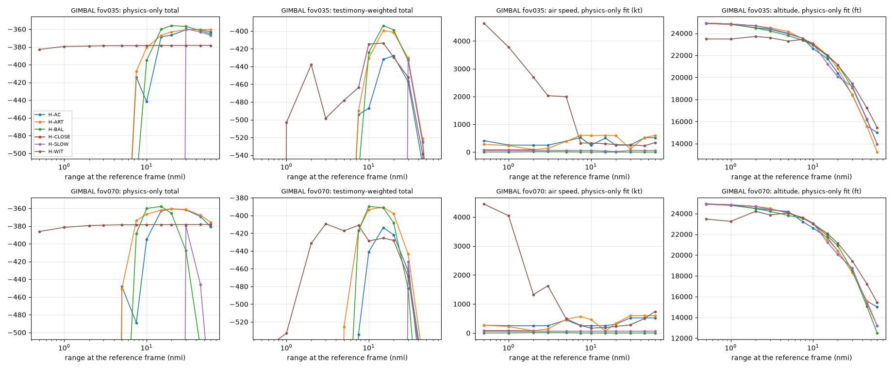

# GIMBAL: hypothesis scores (M3.5)

Generated by `python -m solve.score gimbal` (one run per field of view) then `python -m solve.results_report gimbal` from `data/derived/gimbal/results.json` and `scores.csv`. Design: `docs/design/scoring.md` (binding). Nothing on this page is a verdict about what the object was: these are likelihoods under stated conditions.

**Status flags (read first):**

- At 0.35 deg: D-016: apparent-size criterion reported with weight 0 (blob major axis 24.6 px is under 3 x the point-spread width 9.8 px); resolution not established.
- REVIEW-M3 Rule B: brightness criterion reported with weight 0 (B1 saturation: blob saturated on 64 percent of scored frames, gain and level explain 14 percent of its variance); not range-informative.
- At 0.7 deg: D-017: apparent-size criterion reported with weight 0 (resolved, but the blob is saturated on 64 percent of its scored frames, over the 50 percent limit of Rule B1); size is clipped, not range-informative.
- Testimony: solve/testimony.py: 9 claim terms scored.
- Field of view is a sensor setting, not a hypothesis parameter: every hypothesis is scored at 0.35 deg and again at 0.7 deg, and the two runs are reported side by side, never mixed.
- Review: the four M3 review items (brightness audit, equal range priors, ERA5 turn rate, point-spread width) are resolved in `docs/results/REVIEW-M3.md`; which hypotheses this data can separate at all is in `docs/results/recovery.md`.

## What was scored

- Frames 0 to 1030 (all of them: the object is found on every frame); reference frame 513.
- Every hypothesis was fitted by the same code (maximum likelihood within its prior bounds, multi-start), against the same observables, with the same noise model and weights (`solve/scoring.yaml`). Hypotheses differ only in their physical model and priors (`solve/hypotheses/*.yaml`).
- Shared nuisance parameters, fitted for every hypothesis: the jet's starting heading (not on screen), the wind error at the object's altitude, the sight-line offsets inside the whole-degree readouts, the jet's turn-rate offset inside its measured band, and the jet's pitch (which only moves the pod roll and image horizon).
- Jet turn rate: the lab's own cloud-derived history (`docs/reproductions/gimbal_turn_rate.md`), recomputed with ERA5 winds and temperature (REVIEW-M3 item 3) and re-derived from the same cloud measurement at each field of view: total heading change -65.1 deg at 0.35 deg, -68.6 deg at 0.7 deg; median 1-sigma band 0.022 deg/s, 0.023 deg/s. The cloud motion enters once, as the band's Gaussian on the turn-rate offset (the "cloud motion" row).
- Display rounding (D-016, shared): the readout rounds (fitted once from the azimuth readout's hold times).
- Effective sample sizes (from the data's own autocorrelation, the same for every hypothesis): Azimuth readout 16, Elevation readout 7, Apparent size trend 60, Brightness trend 254, Image rotation 23; total of the criteria in the totals (the BIC n): 45 at 0.35 deg, 45 at 0.7 deg.
- Image rotation: the measured orientation of the blob's major axis on all 1,031 frames, noise 0.68 deg (REVIEW-M3 Rule N, from the data only: the larger of the two-threshold disagreement, 0.25 deg, and the frame-to-frame scatter, 0.68 deg; the earlier running-median value was 0.88 deg). A glare model predicts it from the pod geometry with ONE free offset (Sitrec's glare start angle); a physical model gets a free smooth rotation (a spline). Both get one shared offset for the black-hot segment. These free terms are scored by blocked cross-validation (REVIEW-M3 Rule C: blocks of 46 frames, 5 folds; each block predicted from a fit to the others; the spline's knot count is the best held-out choice), so they are charged by held-out data instead of being counted in k.
- Log-likelihoods: higher is better. A difference of 2.3 is a likelihood ratio of 10. Totals include a complexity penalty of 0.5 k ln(n_eff) for k free parameters (the optimizer's parameters; with the rotation terms cross-validated, every k is below the BIC n).

## Results: both totals at both fields of view

Each total is at its own best fit: testimony-weighted (testimony weight 1.0) and physics-only (testimony weight 0). Rank in brackets.

| Hypothesis | 0.35 deg testimony-weighted | 0.35 deg physics-only | 0.7 deg testimony-weighted | 0.7 deg physics-only | k |
|---|---|---|---|---|---|
| H-BAL: Balloon drifting with the wind | -393.6 (1) | -355.6 (1) | -387.1 (1) | -356.2 (1) | 4 |
| H-ART: Sensor artifact (glare in the pod optics) on a target of any type | -399.8 (2) | -360.2 (3) | -387.3 (2) | -360.5 (2) | 6 |
| H-SLOW: Slow object (bird or small drone) | -403.3 (3) | -359.3 (2) | -411.2 (5) | -367.5 (4) | 6 |
| H-WIT: Object on a free path (no physical model) | -406.3 (4) | -378.3 (5) | -404.7 (3) | -378.3 (5) | 16 |
| H-AC: Distant aircraft (engine exhaust seen as glare) | -421.2 (5) | -360.2 (4) | -410.7 (4) | -360.5 (3) | 6 |
| H-CLOSE: Close small object | -14,856.9 (6) | -14,831.6 (6) | -11,674.3 (6) | -11,648.5 (6) | 6 |

k counts the free parameters fitted by the optimizer (shared nuisances included); the rotation criterion's own free terms are cross-validated instead (REVIEW-M3 Rule C). All six hypotheses are in the design set for GIMBAL.

At 0.35 deg: gap to the leader (H-BAL testimony-weighted, H-BAL physics-only): H-ART -6.3 / -4.7; H-SLOW -9.7 / -3.8; H-WIT -12.7 / -22.8; H-AC -27.6 / -4.7; H-CLOSE -14,463.3 / -14,476.0.

At 0.7 deg: gap to the leader (H-BAL testimony-weighted, H-BAL physics-only): H-ART -0.3 / -4.2; H-WIT -17.6 / -22.1; H-AC -23.7 / -4.2; H-SLOW -24.1 / -11.3; H-CLOSE -11,287.2 / -11,292.3.

## Best-fit object

Range is free for every hypothesis (within its prior), so it is a fitted result here, not an input. Values are means over the clip; "stop/reverse" says whether the fitted ground velocity reverses direction.

### 0.35 deg field of view

| Hypothesis | Fit | Range (nmi) | Altitude (ft) | Air speed (kt) | Ground speed (kt, min) | Ground track (deg) | Vertical speed (ft/min) | Stop/reverse | Jet heading (deg) | Turn-rate offset (sigma) | Jet pitch (deg) | Params at a prior bound |
|---|---|---|---|---|---|---|---|---|---|---|---|---|
| H-BAL | testimony-weighted | 15.7 | 21,675 | 0 | 82 (82) | 75 | 55 | no | 241 | -0.41 | 3.4 | none |
| H-BAL | physics-only | 22.8 | 20,505 | 0 | 83 (83) | 74 | -43 | no | 88 | 0.22 | 3.4 | none |
| H-ART | testimony-weighted | 17.0 | 21,504 | 98 | 27 (27) | 323 | -122 | no | 137 | -0.97 | 3.3 | none |
| H-ART | physics-only | 42.3 | 16,024 | 443 | 421 (421) | 333 | -630 | no | 48 | -0.13 | 3.1 | none |
| H-SLOW | testimony-weighted | 21.2 | 19,996 | 60 | 22 (22) | 64 | 15 | no | 333 | 0.04 | 3.3 | airspeed_kt, altitude constraint (0 to 20,000 ft) |
| H-SLOW | physics-only | 24.8 | 19,995 | 60 | 50 (50) | 28 | -16 | no | 21 | 0.01 | 3.4 | airspeed_kt, altitude constraint (0 to 20,000 ft) |
| H-WIT | testimony-weighted | 13.8 | 22,306 | 322 | 265 (11) | 307 | 2,160 | yes | 349 | -1.64 | 3.3 | none |
| H-WIT | physics-only | 58.9 | 15,382 | 765 | 777 (259) | 25 | 4,324 | yes | 152 | 0.00 | 3.4 | range_ref_nmi |
| H-AC | testimony-weighted | 16.1 | 21,418 | 250 | 156 (156) | 254 | 832 | no | 132 | -0.65 | 3.2 | airspeed_kt |
| H-AC | physics-only | 42.3 | 16,030 | 433 | 364 (364) | 257 | -518 | no | 344 | -0.13 | 3.1 | none |
| H-CLOSE | testimony-weighted | 1.9 | 24,684 | 80 | 18 (18) | 114 | 724 | no | 250 | -4.00 | 3.5 | anchor_daz_deg, turn_rate_z, range_ref_nmi, airspeed_kt |
| H-CLOSE | physics-only | 1.9 | 24,685 | 80 | 141 (141) | 47 | 731 | no | 359 | -4.00 | 3.0 | anchor_daz_deg, turn_rate_z, range_ref_nmi, airspeed_kt |

### 0.7 deg field of view

| Hypothesis | Fit | Range (nmi) | Altitude (ft) | Air speed (kt) | Ground speed (kt, min) | Ground track (deg) | Vertical speed (ft/min) | Stop/reverse | Jet heading (deg) | Turn-rate offset (sigma) | Jet pitch (deg) | Params at a prior bound |
|---|---|---|---|---|---|---|---|---|---|---|---|---|
| H-BAL | testimony-weighted | 11.8 | 22,542 | 0 | 85 (85) | 78 | 21 | no | 93 | 0.26 | 3.4 | none |
| H-BAL | physics-only | 12.5 | 22,436 | 0 | 88 (88) | 77 | -6 | no | 90 | 0.78 | 3.4 | none |
| H-ART | testimony-weighted | 13.1 | 21,959 | 103 | 16 (16) | 264 | 820 | no | 112 | -0.22 | 3.1 | none |
| H-ART | physics-only | 22.9 | 19,765 | 459 | 387 (387) | 286 | -548 | no | 5 | -0.12 | 3.1 | none |
| H-WIT | testimony-weighted | 12.6 | 22,391 | 94 | 19 (7) | 144 | 531 | yes | 358 | -1.81 | 3.2 | none |
| H-WIT | physics-only | 58.9 | 15,409 | 969 | 981 (635) | 26 | 4,277 | no | 165 | 0.00 | 3.4 | range_ref_nmi |
| H-AC | testimony-weighted | 12.0 | 22,393 | 250 | 153 (153) | 257 | 807 | no | 129 | -0.38 | 3.1 | airspeed_kt |
| H-AC | physics-only | 23.2 | 19,689 | 510 | 587 (587) | 56 | -722 | no | 134 | -0.13 | 3.1 | none |
| H-SLOW | testimony-weighted | 20.6 | 19,997 | 60 | 34 (34) | 110 | 20 | no | 28 | 2.23 | 2.9 | altitude constraint (0 to 20,000 ft) |
| H-SLOW | physics-only | 21.8 | 19,997 | 60 | 51 (51) | 26 | -34 | no | 70 | 2.37 | 3.3 | airspeed_kt, altitude constraint (0 to 20,000 ft) |
| H-CLOSE | testimony-weighted | 1.9 | 24,684 | 68 | 29 (29) | 81 | 773 | no | 251 | -4.00 | 2.9 | anchor_daz_deg, turn_rate_z, range_ref_nmi |
| H-CLOSE | physics-only | 1.9 | 24,683 | 69 | 130 (130) | 51 | 773 | no | 352 | -4.00 | 2.9 | anchor_daz_deg, turn_rate_z, range_ref_nmi |

All fitted parameters (both fits, both fields of view) are in `results.json`.

## With and without the data-quality exclusions (REVIEW-M3 Rule X)

The brightness audit (Rule B), D-016 and D-017 were not decided blind: D-017 was an owner ruling made with both 0.7 deg rankings visible, and the brightness and size reviews were prompted by provisional rankings (`docs/results/REVIEW-M3.md`, section 7). So every hypothesis is also refitted with every pre-registered criterion at its design weight. Ranks in brackets.

### 0.35 deg

Excluded by the data-quality rules on this run: Apparent size trend (D-016: apparent-size criterion reported with weight 0 (blob major axis 24.6 px is under 3 x the point-spread width 9.8 px); resolution not established.); Brightness trend (REVIEW-M3 Rule B: brightness criterion reported with weight 0 (B1 saturation: blob saturated on 64 percent of scored frames, gain and level explain 14 percent of its variance); not range-informative.). Without exclusions every criterion carries its design weight (1.0) and the BIC n is 360 instead of 45. Both runs are full refits through the same path.

| Hypothesis | With exclusions: testimony-weighted | With exclusions: physics-only | Without exclusions: testimony-weighted | Without exclusions: physics-only |
|---|---|---|---|---|
| H-BAL | -393.6 (1) | -355.6 (1) | -261.7 (5) | -115.1 (5) |
| H-ART | -399.8 (2) | -360.2 (3) | -110.2 (3) | 29.4 (2) |
| H-SLOW | -403.3 (3) | -359.3 (2) | -234.5 (4) | -108.4 (4) |
| H-WIT | -406.3 (4) | -378.3 (5) | -22.6 (1) | 35.3 (1) |
| H-AC | -421.2 (5) | -360.2 (4) | -110.2 (2) | 23.1 (3) |
| H-CLOSE | -14,856.9 (6) | -14,831.6 (6) | -27,199.2 (6) | -27,168.9 (6) |

**In plain words:** the physics-only leader changes from H-BAL with the exclusions to H-WIT without them (order H-BAL, H-SLOW, H-ART, H-AC, H-WIT, H-CLOSE becomes H-WIT, H-ART, H-AC, H-SLOW, H-BAL, H-CLOSE); the testimony-weighted leader changes from H-BAL with the exclusions to H-WIT without them (order H-BAL, H-ART, H-SLOW, H-WIT, H-AC, H-CLOSE becomes H-WIT, H-AC, H-ART, H-SLOW, H-BAL, H-CLOSE).

### 0.7 deg

Excluded by the data-quality rules on this run: Apparent size trend (D-017: apparent-size criterion reported with weight 0 (resolved, but the blob is saturated on 64 percent of its scored frames, over the 50 percent limit of Rule B1); size is clipped, not range-informative.); Brightness trend (REVIEW-M3 Rule B: brightness criterion reported with weight 0 (B1 saturation: blob saturated on 64 percent of scored frames, gain and level explain 14 percent of its variance); not range-informative.). Without exclusions every criterion carries its design weight (1.0) and the BIC n is 360 instead of 45. Both runs are full refits through the same path.

| Hypothesis | With exclusions: testimony-weighted | With exclusions: physics-only | Without exclusions: testimony-weighted | Without exclusions: physics-only |
|---|---|---|---|---|
| H-BAL | -387.1 (1) | -356.2 (1) | -307.5 (5) | -245.3 (5) |
| H-ART | -387.3 (2) | -360.5 (2) | -107.7 (2) | 32.8 (2) |
| H-WIT | -404.7 (3) | -378.3 (5) | -20.7 (1) | 35.4 (1) |
| H-AC | -410.7 (4) | -360.5 (3) | -107.8 (3) | 27.7 (3) |
| H-SLOW | -411.2 (5) | -367.5 (4) | -262.2 (4) | -198.3 (4) |
| H-CLOSE | -11,674.3 (6) | -11,648.5 (6) | -23,716.4 (6) | -23,686.1 (6) |

**In plain words:** the physics-only leader changes from H-BAL with the exclusions to H-WIT without them (order H-BAL, H-ART, H-AC, H-SLOW, H-WIT, H-CLOSE becomes H-WIT, H-ART, H-AC, H-SLOW, H-BAL, H-CLOSE); the testimony-weighted leader changes from H-BAL with the exclusions to H-WIT without them (order H-BAL, H-ART, H-WIT, H-AC, H-SLOW, H-CLOSE becomes H-WIT, H-ART, H-AC, H-SLOW, H-BAL, H-CLOSE).

## Per-criterion log-likelihoods (testimony-weighted fit)

### 0.35 deg

| Criterion | Weight | H-BAL | H-ART | H-SLOW | H-WIT | H-AC | H-CLOSE |
|---|---|---|---|---|---|---|---|
| Azimuth readout | 1.0 | -4.6 | -13.7 | -1.8 | -2.0 | -13.0 | -14,459.4 |
| Elevation readout | 1.0 | -0.0 | -0.1 | -1.9 | -0.2 | -0.6 | -1.4 |
| Apparent size trend (weight 0) | 0.0 | -21.2 | 121.5 | 30.8 | -33.4 | 121.5 | -4,609.1 |
| Image rotation | 1.0 | -346.4 | -344.5 | -346.4 | -346.4 | -342.8 | -350.7 |
| Brightness trend (weight 0) | 0.0 | -49.1 | -138.4 | 108.0 | -38.9 | -401.2 | -13,799.9 |
| Cloud motion (turn-rate band) | 1.0 | -0.1 | -0.5 | -0.0 | -1.4 | -0.2 | -8.0 |
| Nuisance priors | 1.0 | -0.3 | -0.0 | -0.0 | -0.1 | -1.8 | -1.1 |
| Complexity penalty | 1.0 | -7.6 | -11.5 | -11.5 | -30.5 | -11.5 | -11.5 |
| Testimony (before weight) | 1.0 | -34.5 | -29.7 | -41.8 | -25.8 | -51.3 | -24.8 |

- Apparent size trend at 0.35 deg: shown but weight 0 (D-016: the blob is not resolved against the point-spread width measured on this video (REVIEW-M3 item 4)), so it enters no total.
- Brightness trend at 0.35 deg: shown but weight 0 (REVIEW-M3 Rule B: the blob is saturated, so its integrated contrast is not range-informative), so it enters no total.

### 0.7 deg

| Criterion | Weight | H-BAL | H-ART | H-WIT | H-AC | H-SLOW | H-CLOSE |
|---|---|---|---|---|---|---|---|
| Azimuth readout | 1.0 | -2.3 | -9.5 | -1.9 | -10.2 | -5.2 | -11,276.0 |
| Elevation readout | 1.0 | -0.0 | -0.7 | -0.1 | -0.7 | -5.2 | -1.3 |
| Apparent size trend (weight 0) | 0.0 | -70.6 | 121.5 | -14.9 | 121.5 | 14.3 | -5,494.3 |
| Image rotation | 1.0 | -346.4 | -341.2 | -346.4 | -341.6 | -346.2 | -351.0 |
| Brightness trend (weight 0) | 0.0 | -197.2 | -304.2 | -26.7 | -807.0 | 57.1 | -16,463.3 |
| Cloud motion (turn-rate band) | 1.0 | -0.0 | -0.0 | -1.6 | -0.1 | -2.5 | -8.0 |
| Nuisance priors | 1.0 | -0.3 | -0.4 | -0.1 | -1.8 | -0.2 | -1.3 |
| Complexity penalty | 1.0 | -7.6 | -11.5 | -30.5 | -11.5 | -11.5 | -11.5 |
| Testimony (before weight) | 1.0 | -30.3 | -24.1 | -24.0 | -45.0 | -40.3 | -25.2 |

- Apparent size trend at 0.7 deg: shown but weight 0 (D-017: the blob is resolved but saturated (Rule B1 saturation flag), so its size is clipped, not range-informative), so it enters no total.
- Brightness trend at 0.7 deg: shown but weight 0 (REVIEW-M3 Rule B: the blob is saturated, so its integrated contrast is not range-informative), so it enters no total.

## Per-criterion log-likelihoods (physics-only fit)

### 0.35 deg

| Criterion | Weight | H-BAL | H-ART | H-SLOW | H-WIT | H-AC | H-CLOSE |
|---|---|---|---|---|---|---|---|
| Azimuth readout | 1.0 | -1.5 | -9.1 | -1.5 | -1.5 | -9.1 | -14,458.7 |
| Elevation readout | 1.0 | -0.0 | -0.5 | -0.0 | -0.0 | -0.5 | -1.4 |
| Apparent size trend (weight 0) | 0.0 | 19.6 | 121.5 | 37.5 | 15.3 | 121.5 | -4,614.2 |
| Image rotation | 1.0 | -346.4 | -339.0 | -346.3 | -346.3 | -339.0 | -350.6 |
| Brightness trend (weight 0) | 0.0 | 73.1 | 246.0 | 127.8 | 101.8 | 246.0 | -13,815.1 |
| Cloud motion (turn-rate band) | 1.0 | -0.0 | -0.0 | -0.0 | -0.0 | -0.0 | -8.0 |
| Nuisance priors | 1.0 | -0.0 | -0.1 | -0.0 | -0.0 | -0.1 | -1.4 |
| Complexity penalty | 1.0 | -7.6 | -11.5 | -11.5 | -30.5 | -11.5 | -11.5 |
| Testimony (before weight) | 0.0 | -50.8 | -367.9 | -53.6 | -1,179.2 | -305.2 | -42.1 |

- Apparent size trend at 0.35 deg: shown but weight 0 (D-016: the blob is not resolved against the point-spread width measured on this video (REVIEW-M3 item 4)), so it enters no total.
- Brightness trend at 0.35 deg: shown but weight 0 (REVIEW-M3 Rule B: the blob is saturated, so its integrated contrast is not range-informative), so it enters no total.

### 0.7 deg

| Criterion | Weight | H-BAL | H-ART | H-WIT | H-AC | H-SLOW | H-CLOSE |
|---|---|---|---|---|---|---|---|
| Azimuth readout | 1.0 | -1.9 | -9.2 | -1.4 | -9.1 | -5.8 | -11,275.5 |
| Elevation readout | 1.0 | -0.0 | -0.5 | -0.0 | -0.5 | -1.1 | -1.3 |
| Apparent size trend (weight 0) | 0.0 | -56.4 | 121.5 | 12.7 | 121.5 | 19.8 | -5,496.3 |
| Image rotation | 1.0 | -346.4 | -339.2 | -346.3 | -339.2 | -346.3 | -351.0 |
| Brightness trend (weight 0) | 0.0 | -154.5 | 259.3 | 85.7 | 263.5 | 73.8 | -16,469.2 |
| Cloud motion (turn-rate band) | 1.0 | -0.3 | -0.0 | -0.0 | -0.0 | -2.8 | -8.0 |
| Nuisance priors | 1.0 | -0.0 | -0.1 | -0.0 | -0.1 | -0.1 | -1.3 |
| Complexity penalty | 1.0 | -7.6 | -11.5 | -30.5 | -11.5 | -11.5 | -11.5 |
| Testimony (before weight) | 0.0 | -31.4 | -233.7 | -1,419.1 | -493.7 | -44.3 | -39.1 |

- Apparent size trend at 0.7 deg: shown but weight 0 (D-017: the blob is resolved but saturated (Rule B1 saturation flag), so its size is clipped, not range-informative), so it enters no total.
- Brightness trend at 0.7 deg: shown but weight 0 (REVIEW-M3 Rule B: the blob is saturated, so its integrated contrast is not range-informative), so it enters no total.

## The rotation test

### 0.35 deg

| Hypothesis | Kind | Fitted rotation terms | Rotation log-likelihood (held-out) | Terms charged in k | Residual RMS, in-sample (deg) | Residual RMS, held-out (deg) | Largest residual (deg) | Glare offset (deg) |
|---|---|---|---|---|---|---|---|---|
| H-AC | glare | 2 (1 model + shared) | -342.8 | 0 | 3.56 | 3.64 | 16.2 | 56.7 |
| H-ART | glare | 2 (1 model + shared) | -344.5 | 0 | 3.57 | 3.65 | 16.2 | 56.8 |
| H-SLOW | physical | 17 (16 model + shared) | -346.4 | 0 | 2.84 | 3.66 | 17.9 | n/a |
| H-WIT | physical | 17 (16 model + shared) | -346.4 | 0 | 2.84 | 3.66 | 17.9 | n/a |
| H-BAL | physical | 17 (16 model + shared) | -346.4 | 0 | 2.84 | 3.66 | 17.9 | n/a |
| H-CLOSE | physical | 17 (16 model + shared) | -350.7 | 0 | 2.84 | 3.68 | 18.0 | n/a |

Rotation noise (REVIEW-M3 Rule N, data only): two-threshold disagreement 0.25 deg, frame-to-frame scatter 0.68 deg, so sigma = 0.68 deg (the earlier running-median value was 0.88 deg). The table rescores the rotation criterion at other sigmas at each fit's own best parameters (not refitted); only the rotation row changes.

| Hypothesis | sigma 0.68: rotation / physics-only total | sigma 0.88: rotation / physics-only total | sigma 1.30: rotation / physics-only total | sigma 2.00: rotation / physics-only total | sigma 3.00: rotation / physics-only total |
|---|---|---|---|---|---|
| H-BAL | -346.4 / -355.6 | -214.8 / -224.0 | -117.0 / -126.2 | -74.8 / -84.0 | -62.8 / -72.0 |
| H-SLOW | -346.3 / -359.3 | -214.8 / -227.7 | -117.0 / -130.0 | -74.8 / -87.7 | -62.8 / -75.8 |
| H-ART | -339.0 / -360.2 | -210.4 / -231.6 | -115.1 / -136.3 | -73.9 / -95.1 | -62.5 / -83.7 |
| H-AC | -339.0 / -360.2 | -210.4 / -231.6 | -115.1 / -136.3 | -73.9 / -95.1 | -62.5 / -83.7 |
| H-WIT | -346.3 / -378.3 | -214.7 / -246.7 | -117.0 / -149.0 | -74.8 / -106.8 | -62.8 / -94.8 |
| H-CLOSE | -350.6 / -14,831.6 | -217.2 / -14,698.2 | -118.2 / -14,599.2 | -75.2 / -14,556.3 | -63.0 / -14,544.1 |

Leader at each sigma (physics-only / testimony-weighted, rescored): 0.88 deg: H-BAL / H-BAL; 1.30 deg: H-BAL / H-BAL; 2.00 deg: H-BAL / H-BAL; 3.00 deg: H-BAL / H-BAL.

Measured steps (found from the orientation series alone, no model): f719 (9 deg), f818 (15 deg), f866 (22 deg), f891 (17 deg), f912 (16 deg), f981 (28 deg). The findings log lists window centres 728, 824, 877, 908 and 974 from the extraction's own step finder; f866 to f920 is a fast continuous turn rather than a clean step, which this finder splits.

Residual jump left at each step (mean residual 5 to 20 frames after minus 5 to 20 before; 0 means the model reproduces the step):

| Step frame | Measured change (deg) | H-AC glare, smooth derotation | H-SLOW physical spline |
|---|---|---|---|
| 719 | 8.6 | 6.7 | 4.8 |
| 818 | 15.0 | 7.9 | 8.3 |
| 866 | 22.0 | 9.8 | 5.8 |
| 891 | 16.7 | 3.0 | 1.3 |
| 912 | 15.7 | 1.3 | 2.5 |
| 981 | 28.1 | 18.5 | 19.5 |

Step timing (diagnostic, not in any total). Sitrec's model as specified has a smooth pod roll, so it predicts no steps. To test whether steps follow from the geometry, the pod roll was held by a deadband controller (it stays put until the error exceeds a threshold, then jumps; one extra parameter, not in Sitrec), scanned over its threshold, two error measures (pointing error = sin(ball pitch) x roll error, or roll error itself) and with or without re-centring past the target, on H-AC's best-fit sight line. The best setting overall (pointing, threshold 0.3) makes 59 small steps from f569 on, i.e. it tracks almost continuously, and changes the rotation score by 1.7 after its penalty.

Restricted to settings that make about as many steps as were measured (between half and twice as many from f569 on), the best is pointing, re-centring, threshold 0.8: predicted pod-roll steps at f610, f688, f746, f787, f819, f847, f872, f897, f923, f951, f983, f1020. 4 of the 6 measured steps have a predicted step within 10 frames (nearest: f719 to f746 (+27), f818 to f819 (+1), f866 to f872 (+6), f891 to f897 (+6), f912 to f923 (+11), f981 to f983 (+2)); 8 predicted steps have no measured counterpart. Rotation log-likelihood -412.3 against -342.8 for the smooth derotation (residual RMS 3.90 deg); change after one parameter's penalty -71.4.

Against the findings-log step frames (728, 824, 877, 908, 974): nearest predicted step f728: f746 (+18), f824: f819 (-5), f877: f872 (-5), f908: f897 (-11), f974: f983 (+9).

Best of each controller variant (any step count): pointing threshold 0.3: log-likelihood -339.2; pointing_reflect threshold 0.1: log-likelihood -346.9; roll threshold 1.0: log-likelihood -345.7; roll_reflect threshold 1.0: log-likelihood -352.7.

**In plain words (0.35 deg):** Sitrec's glare model, the pod geometry with one fitted offset, reproduces the overall sweep of the image rotation (residual RMS 3.6 deg; fitted offset 56.7 deg, against Sitrec's own starting value of 57.7 deg). With the pod roll following the geometry its rotation is smooth, so it leaves residual jumps of up to 19 deg at the measured step frames. A physical object given a free smooth rotation fits with residual RMS 2.8 deg in-sample using 16 knots, but predicts held-out stretches with residual RMS 3.7 deg (the glare: 3.6 deg). Scored on held-out data, the glare derotation is better on this criterion by 3.5 log units at sigma 0.68 deg. Making the pod roll step (a deadband controller, one extra parameter, tuned to make about the measured number of steps) puts a predicted step within 10 frames of 4 of the 6 measured steps, with 8 predicted steps that have no measured counterpart, and changes the rotation score by -71.4 after its penalty. That is a likelihood ratio under 100, small next to the sigma sensitivity above: with held-out scoring the rotation does not clearly separate a glare fixed in the optics from a physical object. What the glare model gets right is the size and direction of the total turn and the fast turn near the azimuth crossing; what neither model captures is the step timing.

### 0.7 deg

| Hypothesis | Kind | Fitted rotation terms | Rotation log-likelihood (held-out) | Terms charged in k | Residual RMS, in-sample (deg) | Residual RMS, held-out (deg) | Largest residual (deg) | Glare offset (deg) |
|---|---|---|---|---|---|---|---|---|
| H-ART | glare | 2 (1 model + shared) | -341.2 | 0 | 3.55 | 3.63 | 16.1 | 56.7 |
| H-AC | glare | 2 (1 model + shared) | -341.6 | 0 | 3.56 | 3.63 | 16.1 | 56.9 |
| H-SLOW | physical | 17 (16 model + shared) | -346.2 | 0 | 2.84 | 3.66 | 17.9 | n/a |
| H-WIT | physical | 17 (16 model + shared) | -346.4 | 0 | 2.84 | 3.66 | 17.9 | n/a |
| H-BAL | physical | 17 (16 model + shared) | -346.4 | 0 | 2.84 | 3.66 | 17.9 | n/a |
| H-CLOSE | physical | 17 (16 model + shared) | -351.0 | 0 | 2.84 | 3.69 | 18.0 | n/a |

Rotation noise (REVIEW-M3 Rule N, data only): two-threshold disagreement 0.25 deg, frame-to-frame scatter 0.68 deg, so sigma = 0.68 deg (the earlier running-median value was 0.88 deg). The table rescores the rotation criterion at other sigmas at each fit's own best parameters (not refitted); only the rotation row changes.

| Hypothesis | sigma 0.68: rotation / physics-only total | sigma 0.88: rotation / physics-only total | sigma 1.30: rotation / physics-only total | sigma 2.00: rotation / physics-only total | sigma 3.00: rotation / physics-only total |
|---|---|---|---|---|---|
| H-BAL | -346.4 / -356.2 | -214.8 / -224.7 | -117.0 / -126.9 | -74.8 / -84.7 | -62.8 / -72.7 |
| H-ART | -339.2 / -360.5 | -210.5 / -231.8 | -115.1 / -136.4 | -73.9 / -95.2 | -62.5 / -83.7 |
| H-AC | -339.2 / -360.5 | -210.5 / -231.8 | -115.1 / -136.4 | -73.9 / -95.2 | -62.5 / -83.7 |
| H-SLOW | -346.3 / -367.5 | -214.7 / -236.0 | -117.0 / -138.3 | -74.8 / -96.0 | -62.8 / -84.1 |
| H-WIT | -346.3 / -378.3 | -214.7 / -246.7 | -117.0 / -149.0 | -74.8 / -106.8 | -62.8 / -94.8 |
| H-CLOSE | -351.0 / -11,648.5 | -217.5 / -11,515.0 | -118.3 / -11,415.8 | -75.3 / -11,372.9 | -63.1 / -11,360.6 |

Leader at each sigma (physics-only / testimony-weighted, rescored): 0.88 deg: H-BAL / H-BAL; 1.30 deg: H-BAL / H-BAL; 2.00 deg: H-BAL / H-BAL; 3.00 deg: H-BAL / H-BAL.

Measured steps (found from the orientation series alone, no model): f719 (9 deg), f818 (15 deg), f866 (22 deg), f891 (17 deg), f912 (16 deg), f981 (28 deg). The findings log lists window centres 728, 824, 877, 908 and 974 from the extraction's own step finder; f866 to f920 is a fast continuous turn rather than a clean step, which this finder splits.

Residual jump left at each step (mean residual 5 to 20 frames after minus 5 to 20 before; 0 means the model reproduces the step):

| Step frame | Measured change (deg) | H-ART glare, smooth derotation | H-SLOW physical spline |
|---|---|---|---|
| 719 | 8.6 | 6.7 | 4.8 |
| 818 | 15.0 | 8.0 | 8.3 |
| 866 | 22.0 | 9.8 | 5.8 |
| 891 | 16.7 | 3.0 | 1.3 |
| 912 | 15.7 | 1.3 | 2.5 |
| 981 | 28.1 | 18.5 | 19.5 |

Step timing (diagnostic, not in any total). Sitrec's model as specified has a smooth pod roll, so it predicts no steps. To test whether steps follow from the geometry, the pod roll was held by a deadband controller (it stays put until the error exceeds a threshold, then jumps; one extra parameter, not in Sitrec), scanned over its threshold, two error measures (pointing error = sin(ball pitch) x roll error, or roll error itself) and with or without re-centring past the target, on H-ART's best-fit sight line. The best setting overall (pointing, threshold 0.2) makes 82 small steps from f569 on, i.e. it tracks almost continuously, and changes the rotation score by 0.6 after its penalty.

Restricted to settings that make about as many steps as were measured (between half and twice as many from f569 on), the best is pointing, threshold 1.5: predicted pod-roll steps at f577, f668, f735, f781, f815, f844, f869, f894, f919, f945, f974, f1006. 5 of the 6 measured steps have a predicted step within 10 frames (nearest: f719 to f735 (+16), f818 to f815 (-3), f866 to f869 (+3), f891 to f894 (+3), f912 to f919 (+7), f981 to f974 (-7)); 7 predicted steps have no measured counterpart. Rotation log-likelihood -434.1 against -341.2 for the smooth derotation (residual RMS 4.02 deg); change after one parameter's penalty -94.8.

Against the findings-log step frames (728, 824, 877, 908, 974): nearest predicted step f728: f735 (+7), f824: f815 (-9), f877: f869 (-8), f908: f919 (+11), f974: f974 (+0).

Best of each controller variant (any step count): pointing threshold 0.2: log-likelihood -338.7; pointing_reflect threshold 0.1: log-likelihood -343.7; roll threshold 1.0: log-likelihood -344.4; roll_reflect threshold 1.0: log-likelihood -350.5.

**In plain words (0.7 deg):** Sitrec's glare model, the pod geometry with one fitted offset, reproduces the overall sweep of the image rotation (residual RMS 3.6 deg; fitted offset 56.7 deg, against Sitrec's own starting value of 57.7 deg). With the pod roll following the geometry its rotation is smooth, so it leaves residual jumps of up to 19 deg at the measured step frames. A physical object given a free smooth rotation fits with residual RMS 2.8 deg in-sample using 16 knots, but predicts held-out stretches with residual RMS 3.7 deg (the glare: 3.6 deg). Scored on held-out data, the glare derotation is better on this criterion by 5.0 log units at sigma 0.68 deg. Making the pod roll step (a deadband controller, one extra parameter, tuned to make about the measured number of steps) puts a predicted step within 10 frames of 5 of the 6 measured steps, with 7 predicted steps that have no measured counterpart, and changes the rotation score by -94.8 after its penalty. So on this criterion the pod geometry predicts the rotation better than a free rotation can on held-out stretches; the step timing is the part it does not capture.

## Testimony claims that bear on this video

Scored by `solve/testimony.py` (the same claims for every hypothesis; firsthand weight 1.0, relayed 0.5; recalled numbers never tighter than 25 percent). Each cell: predicted value, weighted log-likelihood (testimony-weighted fit).

### 0.35 deg

| Claim | Quantity | Claimed | H-BAL | H-ART | H-SLOW | H-WIT | H-AC | H-CLOSE |
|---|---|---|---|---|---|---|---|---|
| G-T09 | ground_speed_kt | 0 to 30 (20.0) | 82.0, -8.8 | 27.1, -4.2 | 22.3, -4.1 | 55.5, -5.7 | 156.4, -26.2 | 17.7, -4.0 |
| G-T09 | object_altitude_ft | 15,000 to 25,000 (6,250.0) | 21,675.3, -9.8 | 21,503.7, -9.8 | 19,996.4, -9.8 | 22,289.8, -9.8 | 21,418.4, -9.8 | 24,684.3, -10.0 |
| G-T11 | stops_and_reverses | True | no, -2.3 | no, -2.3 | no, -2.3 | yes, -0.1 | no, -2.3 | no, -2.3 |
| G-T12 | range_nmi | 0 to 10 (2.5) | 15.8, -3.4 | 17.0, -4.2 | 21.3, -7.5 | 13.9, -2.6 | 16.2, -3.7 | 2.0, -1.3 |
| G-T13 | range_nmi | 6 to 8 (2.0) | 15.8, -5.3 | 17.0, -6.7 | 21.3, -12.8 | 13.9, -3.6 | 16.2, -5.7 | 2.0, -2.3 |
| G-T14 | range_trend | decreasing | decreasing, -0.1 | decreasing, -0.1 | decreasing, -0.1 | increasing, -1.2 | decreasing, -0.1 | decreasing, -0.1 |
| G-T21 | motion_vs_wind | against | with, -2.3 | against, -0.1 | with, -2.3 | against, -0.1 | against, -0.1 | with, -2.3 |
| G-T25 | reversal_radius_ft | 50 to 500 (0.5) | n/a, 0.0 | n/a, 0.0 | n/a, 0.0 | 167.5, -0.4 | n/a, 0.0 | n/a, 0.0 |
| G-T28 | ground_speed_kt|air_speed_kt | 90 to 110 (27.5) | 82 / 4, -2.6 | 27 / 98, -2.5 | 22 / 61, -2.9 | 55 / 109, -2.4 | 156 / 241, -3.5 | 18 / 82, -2.6 |
| Total (before weight) | | | -34.5 | -29.7 | -41.8 | -25.8 | -51.3 | -24.8 |

### 0.7 deg

| Claim | Quantity | Claimed | H-BAL | H-ART | H-WIT | H-AC | H-SLOW | H-CLOSE |
|---|---|---|---|---|---|---|---|---|
| G-T09 | ground_speed_kt | 0 to 30 (20.0) | 84.8, -9.2 | 16.3, -4.0 | 15.9, -4.0 | 153.0, -25.1 | 33.8, -4.4 | 29.0, -4.2 |
| G-T09 | object_altitude_ft | 15,000 to 25,000 (6,250.0) | 22,542.1, -9.8 | 21,959.1, -9.8 | 22,405.8, -9.8 | 22,393.3, -9.8 | 19,997.0, -9.8 | 24,683.7, -10.0 |
| G-T11 | stops_and_reverses | True | no, -2.3 | no, -2.3 | yes, -0.1 | no, -2.3 | no, -2.3 | no, -2.3 |
| G-T12 | range_nmi | 0 to 10 (2.5) | 11.9, -1.9 | 13.2, -2.3 | 12.7, -2.1 | 12.0, -1.9 | 20.6, -6.9 | 2.0, -1.3 |
| G-T13 | range_nmi | 6 to 8 (2.0) | 11.9, -2.2 | 13.2, -3.1 | 12.7, -2.7 | 12.0, -2.3 | 20.6, -11.7 | 2.0, -2.3 |
| G-T14 | range_trend | decreasing | decreasing, -0.1 | decreasing, -0.1 | decreasing, -0.1 | decreasing, -0.1 | decreasing, -0.1 | decreasing, -0.1 |
| G-T21 | motion_vs_wind | against | with, -2.3 | against, -0.1 | neither, -2.3 | against, -0.1 | with, -2.3 | with, -2.3 |
| G-T25 | reversal_radius_ft | 50 to 500 (0.5) | n/a, 0.0 | n/a, 0.0 | 118.2, -0.4 | n/a, 0.0 | n/a, 0.0 | n/a, 0.0 |
| G-T28 | ground_speed_kt|air_speed_kt | 90 to 110 (27.5) | 85 / 4, -2.5 | 16 / 103, -2.5 | 16 / 92, -2.5 | 153 / 241, -3.4 | 34 / 59, -2.9 | 29 / 67, -2.8 |
| Total (before weight) | | | -30.3 | -24.1 | -24.0 | -45.0 | -40.3 | -25.2 |

## Per-hypothesis curves over range

For each hypothesis, the range at the reference frame is held fixed on a grid and every other parameter is refitted (both totals, with the exclusions, ERA5 winds; fewer random starts than the main fits, so a point can sit slightly below a full fit). Full table: `data/derived/gimbal/range_curves.csv`; plot: `docs/results/gimbal_range_curves.png`. Below: physics-only total, and the implied air speed (kt) / altitude (ft) / largest acceleration (g) at the physics-only fit; a dash outside the hypothesis's prior.

**0.35 deg**

| Range (nmi) | H-AC | H-ART | H-BAL | H-CLOSE | H-SLOW | H-WIT |
|---|---|---|---|---|---|---|
| 0.5 | -441,935.0; 414 / 24,887 / 0.00 | -444,284.0; 282 / 24,889 / 0.00 | -5,053,190.0; 1 / 24,921 / 0.00 | -4,067,520.0; 80 / 24,921 / 0.00 | -6,370,590.0; 60 / 24,921 / 0.00 | -382.8; 4,642 / 23,483 / 48.41 |
| 1.0 | -93,077.8; 255 / 24,804 / 0.00 | -93,075.6; 235 / 24,790 / 0.00 | -2,562,780.0; 4 / 24,842 / 0.00 | -1,167,520.0; 80 / 24,842 / 0.00 | -3,530,480.0; 60 / 24,842 / 0.00 | -379.5; 3,779 / 23,478 / 43.21 |
| 2.0 | -16,969.1; 250 / 24,501 / 0.00 | -15,008.6; 88 / 24,678 / 0.00 | -47,802.5; 15 / 24,475 / 0.00 | -14,831.6; 80 / 24,684 / 0.00 | -2,014,840.0; 60 / 24,683 / 0.00 | -379.0; 2,700 / 23,714 / 29.17 |
| 3.0 | -5,979.4; 250 / 24,360 / 0.00 | -4,062.9; 137 / 24,500 / 0.00 | -12,190.1; 15 / 24,214 / 0.00 | - | -2,004,180.0; 61 / 24,410 / 0.00 | -378.8; 2,030 / 23,599 / 20.11 |
| 5.0 | -726.8; 395 / 23,950 / 0.00 | -721.8; 386 / 24,160 / 0.00 | -2,194.5; 12 / 23,782 / 0.00 | - | -2,001,030.0; 59 / 23,996 / 0.00 | -378.6; 1,994 / 23,286 / 21.71 |
| 7.5 | -414.2; 520 / 23,534 / 0.00 | -407.4; 600 / 23,496 / 0.00 | -534.7; 5 / 23,356 / 0.00 | - | -2,000,460.0; 60 / 23,544 / 0.00 | -378.6; 326 / 23,448 / 6.25 |
| 10.0 | -441.7; 250 / 22,609 / 0.00 | -380.8; 600 / 23,099 / 0.00 | -395.2; 1 / 22,937 / 0.00 | - | -2,000,390.0; 60 / 23,034 / 0.00 | -378.5; 327 / 22,962 / 6.06 |
| 15.0 | -368.6; 504 / 21,675 / 0.00 | -367.0; 600 / 21,984 / 0.00 | -360.2; 0 / 21,910 / 0.00 | - | -1,210,080.0; 38 / 21,220 / 0.00 | -378.4; 303 / 22,013 / 5.72 |
| 20.0 | -366.8; 250 / 20,384 / 0.00 | -363.0; 600 / 20,800 / 0.00 | -355.9; 0 / 21,126 / 0.00 | - | -3,031.6; 19 / 20,052 / 0.00 | -378.4; 269 / 21,111 / 5.00 |
| 30.0 | -360.8; 250 / 18,435 / 0.00 | -360.7; 119 / 18,376 / 0.00 | -356.9; 0 / 19,054 / 0.00 | - | -359.6; 60 / 19,175 / 0.00 | -378.3; 258 / 19,432 / 4.39 |
| 45.0 | -360.2; 520 / 15,582 / 0.00 | -360.2; 525 / 15,580 / 0.00 | -361.6; 0 / 16,164 / 0.00 | - | -363.2; 60 / 16,235 / 0.00 | -378.3; 232 / 17,244 / 1.96 |
| 60.0 | -363.2; 520 / 15,004 / 0.00 | -360.6; 600 / 13,227 / 0.00 | -365.3; 0 / 13,944 / 0.00 | - | -366.9; 60 / 13,944 / 0.00 | -378.3; 342 / 15,450 / 2.25 |

Ranges within 2.3 log units of each hypothesis's best physics-only point on this grid: H-AC 30.0 to 45.0 nmi; H-ART 30.0 to 60.0 nmi; H-BAL 20.0 to 30.0 nmi; H-CLOSE 2.0 to 2.0 nmi; H-SLOW 30.0 to 30.0 nmi; H-WIT 1.0 to 60.0 nmi.

**0.7 deg**

| Range (nmi) | H-AC | H-ART | H-BAL | H-CLOSE | H-SLOW | H-WIT |
|---|---|---|---|---|---|---|
| 0.5 | -460,898.0; 267 / 24,908 / 0.00 | -460,893.0; 270 / 24,898 / 0.00 | -5,033,940.0; 1 / 24,921 / 0.00 | -4,037,280.0; 80 / 24,921 / 0.00 | -6,344,400.0; 60 / 24,921 / 0.00 | -386.1; 4,450 / 23,463 / 47.79 |
| 1.0 | -92,171.8; 250 / 24,782 / 0.00 | -92,150.8; 221 / 24,789 / 0.00 | -2,544,880.0; 4 / 24,842 / 0.00 | -1,138,250.0; 80 / 24,842 / 0.00 | -3,503,740.0; 60 / 24,842 / 0.00 | -381.5; 4,044 / 23,252 / 46.18 |
| 2.0 | -15,673.9; 250 / 24,502 / 0.00 | -11,893.2; 74 / 24,685 / 0.00 | -32,852.6; 15 / 24,475 / 0.00 | -11,648.4; 70 / 24,683 / 0.00 | -2,011,650.0; 60 / 24,684 / 0.00 | -379.4; 1,325 / 24,208 / 11.87 |
| 3.0 | -5,133.6; 250 / 24,360 / 0.00 | -2,431.2; 140 / 24,507 / 0.00 | -6,760.6; 15 / 24,214 / 0.00 | - | -2,002,540.0; 61 / 24,405 / 0.00 | -378.9; 1,627 / 23,868 / 16.18 |
| 5.0 | -448.0; 450 / 24,197 / 0.00 | -451.0; 473 / 24,022 / 0.00 | -712.5; 11 / 23,818 / 0.00 | - | -2,000,560.0; 60 / 24,094 / 0.00 | -378.6; 491 / 24,053 / 7.15 |
| 7.5 | -489.1; 250 / 23,208 / 0.00 | -373.7; 571 / 23,624 / 0.00 | -388.6; 1 / 23,532 / 0.00 | - | -2,000,380.0; 60 / 23,565 / 0.00 | -378.5; 258 / 23,572 / 4.94 |
| 10.0 | -395.2; 250 / 22,609 / 0.00 | -366.6; 462 / 23,074 / 0.00 | -360.2; 0 / 23,036 / 0.00 | - | -2,000,360.0; 60 / 23,058 / 0.00 | -378.4; 168 / 23,013 / 3.43 |
| 15.0 | -363.0; 250 / 21,646 / 0.00 | -362.0; 68 / 21,535 / 0.00 | -357.8; 0 / 21,852 / 0.00 | - | -1,210,070.0; 63 / 21,220 / 0.00 | -378.4; 187 / 22,057 / 3.56 |
| 20.0 | -360.6; 304 / 20,388 / 0.00 | -360.6; 326 / 20,387 / 0.00 | -365.6; 0 / 20,882 / 0.00 | - | -3,035.6; 60 / 20,052 / 0.00 | -378.3; 225 / 21,134 / 3.31 |
| 30.0 | -361.8; 520 / 18,326 / 0.00 | -361.3; 600 / 18,338 / 0.00 | -407.6; 1 / 18,497 / 0.00 | - | -379.8; 60 / 18,733 / 0.00 | -378.3; 278 / 19,425 / 1.14 |
| 45.0 | -369.1; 520 / 15,565 / 0.00 | -367.6; 600 / 15,567 / 0.00 | -517.2; 1 / 15,062 / 0.00 | - | -445.8; 60 / 15,338 / 0.00 | -378.3; 503 / 17,232 / 2.29 |
| 60.0 | -380.8; 520 / 15,004 / 0.00 | -375.7; 600 / 13,202 / 0.00 | -613.9; 1 / 12,497 / 0.00 | - | -575.5; 60 / 13,210 / 0.00 | -378.3; 740 / 15,427 / 4.33 |

Ranges within 2.3 log units of each hypothesis's best physics-only point on this grid: H-AC 20.0 to 30.0 nmi; H-ART 15.0 to 30.0 nmi; H-BAL 15.0 to 15.0 nmi; H-CLOSE 2.0 to 2.0 nmi; H-SLOW 30.0 to 30.0 nmi; H-WIT 2.0 to 60.0 nmi.

## Range curve from the angles alone

With no range on screen, a constant-velocity object is fitted at each assumed range to the azimuth and elevation readouts (and the turn-rate band). Image cues and testimony are NOT used here. This shows what the sight lines alone allow.

| Assumed range (nmi) | 0.35 deg: air / ground speed (kt), altitude (ft), sight-line log-likelihood | 0.7 deg: air / ground speed (kt), altitude (ft), sight-line log-likelihood |
|---|---|---|
| 2 | 83 / 180, 24,683, -14,460.0 | 69 / 153, 24,682, -11,276.6 |
| 4 | 297 / 389, 24,243, -1,015.1 | 321 / 224, 24,234, -340.0 |
| 6 | 671 / 590, 23,794, -92.4 | 535 / 501, 23,734, -14.8 |
| 8 | 1,005 / 938, 23,286, -10.3 | 480 / 521, 23,491, -5.5 |
| 10 | 1,070 / 978, 23,023, -6.1 | 318 / 388, 23,020, -2.8 |
| 15 | 853 / 913, 22,112, -2.3 | 156 / 235, 22,076, -1.5 |
| 20 | 347 / 425, 21,085, -1.6 | 558 / 630, 21,104, -1.6 |
| 25 | 122 / 178, 20,285, -1.5 | 952 / 1,030, 20,174, -1.7 |
| 30 | 564 / 630, 19,443, -1.5 | 1,303 / 1,251, 19,458, -1.9 |
| 35 | 972 / 1,023, 18,559, -1.5 | 1,679 / 1,626, 18,804, -2.1 |
| 40 | 1,362 / 1,347, 17,956, -1.6 | 2,000 / 1,970, 18,250, -2.2 |

## Conditions each result depends on

- **Field of view** (0.35 or 0.7 deg): changes the cloud-derived turn rate and therefore the jet's path, so every sight line. Reported separately; the documentation-based consensus is 0.35 deg.
- **Wind and temperature**: ERA5 gimbal at 2015-01-25T02:30 UTC (box centre), wind uncertainty 5 kt, jet-level temperature ISA +8.8 K (TAS from Mach uses it). The ERA5 time is nominal: the date and hour of the recording are not certain (the file metadata points to 01/25/2015 near 02 to 03 UTC; the release lists 01/21/2015). The balloon, slow-mover and wind-related testimony terms move with the wind.
- **Turn-rate derivation inputs** (REVIEW-M3 item 3): the cloud-derived turn rate now uses ERA5 at 2015-01-25T02:30Z: jet-level wind 99 kt from 261, cloud-deck wind 50 kt from 264 (deck 11,740 ft nominal), TAS from Mach at ISA +8.8 K; the band draws the time over 01/24 18Z to 01/25 06Z. Against the placeholder inputs the history moved by 0.0051 deg/s rms at 0.35 deg, 0.0054 deg/s rms at 0.7 deg and the band's median half-width went from 0.045 to 0.043 deg/s at 0.35 deg, 0.046 to 0.044 deg/s at 0.7 deg. The jet's initial heading inside the inversion is still a draw in 295 to 335 deg (not on screen).
- **Jet heading**: not on screen; fitted for every hypothesis. Testimony quantities that depend on direction (motion against the wind) inherit that freedom.
- **Turn rate**: the lab's cloud-derived history and its Monte Carlo band (cloud deck height, texture distance, image scale, ERA5 winds and temperature over a 12-hour window, and the jet's initial heading inside it). The horizon-bar bank is used only for the image horizon and pod roll, where the cloud motion's direction confirms it.
- **Jet pitch**: a shared nuisance (Sitrec's 3.6 deg, scaled by 1/cos(bank) as Sitrec does). Near the end of the clip the pod looks within a few degrees of its roll axis, so the predicted glare rotation there is sensitive to pitch and to the azimuth inside its whole-degree interval; both are fitted, the same way for every glare model.
- **Rotation measurement**: the blob's major-axis angle at the high threshold, noise 0.68 deg from the data (Rule N; see the sweep in the rotation section for 0.88 to 3 deg); one shared offset allows a white-hot / black-hot bias. Pixel aspect (frames about 5 percent wide) slightly flattens measured angles and is not corrected (it changes the angles by under 2 deg at 45 deg).
- **Brightness trend**: weight 0 at 0.35 deg, weight 0 at 0.7 deg (where weight 0: REVIEW-M3 Rule B: the blob is saturated, so its integrated contrast is not range-informative; see `docs/results/REVIEW-M3.md`).
- **Apparent size**: weight 0 at 0.35 deg, weight 0 at 0.7 deg (where weight 0: D-016: the blob is not resolved against the point-spread width measured on this video (REVIEW-M3 item 4); D-017: the blob is resolved but saturated (Rule B1 saturation flag), so its size is clipped, not range-informative; see `docs/results/REVIEW-M3.md`).
- **Testimony**: the binding Gaussian edge grows quadratically outside a claim's interval, so a single distant memory can dominate a total; the physics-only column is the reading without it.

## How to read this, and its limits

- Likelihoods, not verdicts. No prior probability is put on any class of explanation; readers can add their own.
- Compare differences between hypotheses within one field of view, not absolute values, and not across fields of view (the jet's path differs).
- Interpretations made where the design was silent: as for GOFAST (n_eff from the data's autocorrelation; the BIC n is the sum of the physics criteria's n_eff; normal-prior nuisances enter through their log prior); plus, for GIMBAL, the cloud motion enters through the turn-rate band, the rotation noise comes from the two-threshold disagreement floored by the frame-to-frame scatter (Rule N), and the rotation criterion's free terms are scored by blocked cross-validation instead of BIC (Rule C).
- BIC counts parameters, not prior width: a wide prior costs nothing extra (recovery.md shows this for GOFAST's glare model).
- Model recovery (M3.4, 0.35 deg, `docs/results/recovery.md`): synthetic data from each hypothesis, scored by the same path (physics-only total). Rows: the hypothesis that made the data; columns: how often each hypothesis won.

| Data made by | H-AC | H-ART | H-BAL | H-CLOSE | H-SLOW | H-WIT | data sets |
|---|---|---|---|---|---|---|---|
| H-AC | 1 | 0 | 2 | 0 | 0 | 0 | 3 |
| H-ART | 0 | 1 | 2 | 0 | 0 | 0 | 3 |
| H-BAL | 0 | 0 | 3 | 0 | 0 | 0 | 3 |
| H-CLOSE | 0 | 0 | 0 | 3 | 0 | 0 | 3 |
| H-SLOW | 0 | 0 | 3 | 0 | 0 | 0 | 3 |
| H-WIT | 0 | 0 | 3 | 0 | 0 | 0 | 3 |

- Model recovery (M3.4, 0.7 deg, `docs/results/recovery.md`): synthetic data from each hypothesis, scored by the same path (physics-only total). Rows: the hypothesis that made the data; columns: how often each hypothesis won.

| Data made by | H-AC | H-ART | H-BAL | H-CLOSE | H-SLOW | H-WIT | data sets |
|---|---|---|---|---|---|---|---|
| H-AC | 0 | 2 | 1 | 0 | 0 | 0 | 3 |
| H-ART | 0 | 2 | 1 | 0 | 0 | 0 | 3 |
| H-BAL | 0 | 0 | 3 | 0 | 0 | 0 | 3 |
| H-CLOSE | 0 | 0 | 0 | 3 | 0 | 0 | 3 |
| H-SLOW | 0 | 0 | 1 | 0 | 1 | 0 | 2 |
| H-WIT | 0 | 0 | 3 | 0 | 0 | 0 | 3 |

- Discriminators for the top pairs (M3.6): see "What would settle it" below and `docs/results/discriminators.md`.

## What would settle it

Full tables, method and data availability: [`discriminators.md`](discriminators.md) (M3.6, `python -m solve.discriminators`, rerun 11/02/2026 after the CP-04 fixes). In short:

- **Radar range near the end of the clip.** Fitted to the video alone, every physical model at 0.35 deg puts the object at 15 nmi or more at 34 s (balloon 15 to 30, slow flier 20 to 36, distant jet 18 to 55, glare on a target 18 to 61 nmi). A radar range of 10 nmi or less (the aircrew's account), good to about 2 nmi, would rule out all four by a likelihood ratio of 10 or more. At 0.7 deg this does not hold: the balloon fits at 9.0 to 13.6 nmi. The aircrew say the radar page was taped with the FLIR; it has not been released.
- **Balloon or slow flier.** At 0.7 deg their ranges do not overlap (9.0 to 13.6 vs 19.2 to 22.1 nmi at the end), so a radar range good to 2.6 nmi separates them both ways. At 0.35 deg only a wind measurement at about 20,000 ft helps, and only one way (it can rule out the balloon, never the slow flier, which may fly at zero air speed).
- **Glare or physical object.** Since the rotation criterion is scored on held-out data (CP-04 fix), it no longer separates them, and the recovery test confirms it (glare-made data are often won by the balloon). A radar range or closure rate separates the glare models from the balloon one way only (the glare models' bands are wide and reach their prior bounds).
- **Pairs no measurement separates.** The distant jet and the glare-on-a-target model are the same physics here. The free path (H-WIT) can sit at any range and speed; its discriminator bands in `discriminators.md` are degenerate (0 nmi) and are not used here.
- **Field of view.** It does not change the physics-only leader with the exclusions (the balloon at both), but changes its lead over the slow flier from 3.7 to 11.3 log units and moves the balloon's end range in from 15 to 30 nmi to 9 to 14 nmi.
- **The exclusions.** Without the data-quality exclusions the free path leads at both fields of view and the balloon is fifth (results above), so any measurement that settles the size and brightness question (an unsaturated recording) also bears on the ranking.

