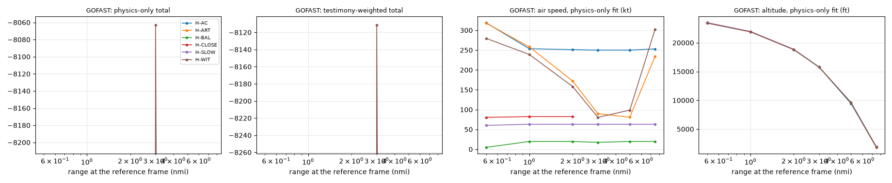

# GOFAST: hypothesis scores (M3)

Generated by `python -m solve.score gofast` then `python -m solve.results_report gofast` from `data/derived/gofast/results.json` and `scores.csv`. Design: `docs/design/scoring.md` (binding).

**Status flags (read first):**

- D-016: apparent-size criterion reported with weight 0 (blob major axis 6.4 px is under 3 x the point-spread width 5.5 px); resolution not established.
- Testimony: solve/testimony.py: 2 claim terms scored.
- Review: the M3 review items (brightness audit, equal range priors, point-spread width) are resolved in `docs/results/REVIEW-M3.md`; which hypotheses this data can separate at all is in `docs/results/recovery.md`.

## What was scored

- Frames 368 to 1030 (the frames with the range readout on screen); reference frame 701.
- Every hypothesis was fitted by the same code (maximum likelihood within its prior bounds, multi-start), against the same observables, with the same noise model and weights (`solve/scoring.yaml`). Hypotheses differ only in their physical model and priors (`solve/hypotheses/*.yaml`).
- Jet heading and the wind error at the object's altitude are fitted for every hypothesis (shared nuisance parameters); the jet's heading is not on screen.
- Effective sample sizes (from the data's own autocorrelation, the same for every hypothesis): Azimuth readout 15, Elevation readout 45, Range readout 57, Closure (Vc) readout 33, Apparent size trend (weight 0) 178, Brightness trend 591, Ocean motion in the image 328; total of the criteria in the totals (the BIC n) 1070.
- Log-likelihoods: higher is better. A difference of 2.3 is a likelihood ratio of 10. Totals include a complexity penalty of 0.5 k ln(n_eff) for k free parameters.

## Results table

Two totals, each at its own best fit: testimony-weighted (testimony weight 1.0) and physics-only (testimony weight 0). "Design set" marks the hypotheses the design table lists for this video; the others were scored too, the same way, for completeness.

| Rank (testimony-weighted) | Hypothesis | Design set | Testimony-weighted total | Physics-only total | Rank (physics-only) | k |
|---|---|---|---|---|---|---|
| 1 | H-BAL: Balloon drifting with the wind | yes | -1,042.2 | -1,028.5 | 1 | 4 |
| 2 | H-ART: Sensor artifact (glare in the pod optics) on a target of any type | no | -1,048.1 | -1,034.4 | 2 | 6 |
| 3 | H-SLOW: Slow object (bird or small drone) | yes | -1,048.1 | -1,034.4 | 3 | 6 |
| 4 | H-WIT: Object on a free path (no physical model) | no | -1,079.1 | -1,065.3 | 4 | 16 |
| 5 | H-AC: Distant aircraft (engine exhaust seen as glare) | no | -20,108.9 | -20,092.2 | 5 | 6 |
| 6 | H-CLOSE: Close small object | no | -48,823.8 | -48,799.0 | 6 | 6 |

Gap to the leader (testimony-weighted, then physics-only): H-ART -5.9 / -5.9; H-SLOW -5.9 / -5.9; H-WIT -36.9 / -36.8; H-AC -19,066.7 / -19,063.7; H-CLOSE -47,781.6 / -47,770.5.

### With and without the data-quality exclusions (REVIEW-M3 Rule X)

The exclusion rules were not decided blind (`docs/results/REVIEW-M3.md`, section 7), so every hypothesis is also refitted with every pre-registered criterion at its design weight.

Excluded by the data-quality rules on this run: Apparent size trend (D-016: apparent-size criterion reported with weight 0 (blob major axis 6.4 px is under 3 x the point-spread width 5.5 px); resolution not established.). Without exclusions every criterion carries its design weight (1.0) and the BIC n is 1248 instead of 1070. Both runs are full refits through the same path.

| Hypothesis | With exclusions: testimony-weighted | With exclusions: physics-only | Without exclusions: testimony-weighted | Without exclusions: physics-only |
|---|---|---|---|---|
| H-BAL | -1,042.2 (1) | -1,028.5 (1) | -944.0 (2) | -930.3 (2) |
| H-ART | -1,048.1 (2) | -1,034.4 (2) | -918.3 (1) | -904.6 (1) |
| H-SLOW | -1,048.1 (3) | -1,034.4 (3) | -950.0 (3) | -936.3 (3) |
| H-WIT | -1,079.1 (4) | -1,065.3 (4) | -982.0 (4) | -968.0 (4) |
| H-AC | -20,108.9 (5) | -20,092.2 (5) | -19,979.1 (5) | -19,962.5 (5) |
| H-CLOSE | -48,823.8 (6) | -48,799.0 (6) | -48,731.8 (6) | -48,707.1 (6) |

**In plain words:** the physics-only leader changes from H-BAL with the exclusions to H-ART without them (order H-BAL, H-ART, H-SLOW, H-WIT, H-AC, H-CLOSE becomes H-ART, H-BAL, H-SLOW, H-WIT, H-AC, H-CLOSE); the testimony-weighted leader changes from H-BAL with the exclusions to H-ART without them (order H-BAL, H-ART, H-SLOW, H-WIT, H-AC, H-CLOSE becomes H-ART, H-BAL, H-SLOW, H-WIT, H-AC, H-CLOSE).

## Best-fit object (testimony-weighted fit)

| Hypothesis | Range (nmi, mean) | Altitude (ft) | Air speed (kt) | Ground speed (kt) | Ground track (deg) | Vertical speed (ft/min) | Jet heading (deg) | Wind error E, N (kt) | Params at a prior bound |
|---|---|---|---|---|---|---|---|---|---|
| H-BAL | 3.85 | 13,212 | 0.8 | 52.9 | 88 | 83 | 258 | -1.7, -5.7 | anchor_del_deg |
| H-ART | 3.85 | 13,212 | 9.7 | 53.7 | 93 | 114 | 253 | -0.0, 0.0 | anchor_del_deg |
| H-SLOW | 3.85 | 13,212 | 9.6 | 53.7 | 93 | 111 | 253 | 0.0, 0.0 | anchor_del_deg |
| H-WIT | 3.84 | 13,224 | 25.8 | 63.0 | 106 | 28 | 231 | 4.5, 9.0 | none |
| H-AC | 3.24 | 14,999 | 250.0 | 284.4 | 66 | -30 | 31 | -20.0, -20.0 | anchor_daz_deg, anchor_del_deg, wind_err_e_kt, wind_err_n_kt, airspeed_kt, altitude constraint (15,000 to 45,000 ft) |
| H-CLOSE | 2.02 | 18,843 | 82.4 | 30.0 | 217 | 1,997 | 242 | -20.0, -20.0 | anchor_daz_deg, anchor_del_deg, wind_err_e_kt, wind_err_n_kt, range_ref_nmi, airspeed_kt, vz_fpm |

All fitted parameters (both fits) are in `results.json`.

## Per-criterion log-likelihoods (testimony-weighted fit)

| Criterion | Weight | H-BAL | H-ART | H-SLOW | H-WIT | H-AC | H-CLOSE |
|---|---|---|---|---|---|---|---|
| Azimuth readout | 1.0 | -11.1 | -10.4 | -10.4 | -5.7 | -10,229.5 | -7,040.6 |
| Elevation readout | 1.0 | -5.1 | -5.0 | -5.0 | -5.3 | -961.4 | -1,996.8 |
| Range readout | 1.0 | -29.4 | -29.4 | -29.4 | -29.3 | -3,636.1 | -36,262.2 |
| Closure (Vc) readout | 1.0 | -292.4 | -293.0 | -292.9 | -291.9 | -1,474.5 | -596.3 |
| Ocean motion in the image | 1.0 | -534.7 | -534.5 | -534.5 | -534.3 | -3,605.0 | -2,708.8 |
| Apparent size trend (weight 0) | 0.0 | 98.5 | 130.2 | 98.5 | 98.5 | 130.2 | 92.4 |
| Brightness trend | 1.0 | -141.3 | -141.3 | -141.3 | -141.2 | -143.5 | -149.3 |
| Nuisance priors | 1.0 | -0.7 | -0.0 | -0.0 | -2.0 | -21.4 | -24.0 |
| Complexity penalty | 1.0 | -14.0 | -20.9 | -20.9 | -55.8 | -20.9 | -20.9 |
| Testimony (before weight) | 1.0 | -13.7 | -13.7 | -13.7 | -13.7 | -16.7 | -24.7 |

## Per-criterion log-likelihoods (physics-only fit)

| Criterion | Weight | H-BAL | H-ART | H-SLOW | H-WIT | H-AC | H-CLOSE |
|---|---|---|---|---|---|---|---|
| Azimuth readout | 1.0 | -11.1 | -10.4 | -10.4 | -6.0 | -10,229.5 | -7,040.6 |
| Elevation readout | 1.0 | -5.1 | -5.0 | -5.0 | -5.0 | -961.6 | -1,996.8 |
| Range readout | 1.0 | -29.4 | -29.4 | -29.4 | -29.3 | -3,636.2 | -36,262.2 |
| Closure (Vc) readout | 1.0 | -292.4 | -293.0 | -293.0 | -291.9 | -1,474.5 | -596.3 |
| Ocean motion in the image | 1.0 | -534.7 | -534.5 | -534.5 | -534.3 | -3,604.7 | -2,708.8 |
| Apparent size trend (weight 0) | 0.0 | 98.5 | 130.2 | 98.5 | 98.5 | 130.2 | 92.4 |
| Brightness trend | 1.0 | -141.3 | -141.3 | -141.3 | -141.2 | -143.5 | -149.3 |
| Nuisance priors | 1.0 | -0.7 | -0.0 | -0.0 | -1.8 | -21.3 | -24.0 |
| Complexity penalty | 1.0 | -14.0 | -20.9 | -20.9 | -55.8 | -20.9 | -20.9 |
| Testimony (before weight) | 0.0 | -13.7 | -13.7 | -13.7 | -13.7 | -16.7 | -24.7 |

- Apparent size trend: shown but weight 0 (D-016: the blob is not resolved against the point-spread width measured on this video (REVIEW-M3 item 4)).

## Closure-rate check

The Vc readout falls from 220 to 150 kt over frames 368 to 1030. If the object hung still in the air at the jet's level, the closing speed would be the jet's own airspeed projected on the line of sight, TAS cos(el) cos(az), which needs no wind and no jet heading: 244 kt at the start and 165 kt at the end.

- Readout minus that projection: mean -23.9 kt, rms 24.4 kt (start -29.8, end -14.9 kt). This is the object's own velocity along the line of sight, relative to the air at the jet's level, plus readout error. A balloon would show only the wind shear between its altitude and the jet's projected on the line of sight; a fast object would add its own speed.
- The range readout's own rate of change is 174.3 kt against a mean Vc readout of 179.3 kt, so Vc and RNG agree on average.
- The top hypothesis (H-BAL) reproduces the Vc readout with an rms error of 10.6 kt.
- Projection uses the readout az/el (whole degrees) and TAS from Mach; az from the nose, so crab angle is ignored.

## Testimony claims that bear on this video

Scored by `solve/testimony.py` (the same claims for every hypothesis; firsthand weight 1.0, relayed 0.5; recalled numbers never tighter than 25 percent). Each cell: predicted value, weighted log-likelihood.

| Claim | Quantity | Claimed interval (sigma) | H-BAL | H-ART | H-SLOW | H-WIT | H-AC | H-CLOSE |
|---|---|---|---|---|---|---|---|---|
| F-T01 | object_altitude_ft | 0.0 to 2,000.0 (2,000.0) | 13,212.2, -12.99 | 13,212.4, -12.99 | 13,212.2, -12.99 | 13,219.3, -13.01 | 14,999.2, -15.77 | 18,842.7, -23.06 |
| F-T04 | range_nmi | 4.3 to 5.0 (1.2) | 3.8, -0.68 | 3.8, -0.68 | 3.8, -0.68 | 3.8, -0.68 | 3.3, -0.88 | 2.0, -1.67 |

Claims about on-screen numbers (jet altitude, the range and Vc fields, polarity) test memory against the record and never enter a hypothesis score (`solve.testimony.witness_consistency`).

## Range curve from the angles alone

If the range readout and Vc are set aside, the azimuth, elevation and ocean motion fit a constant-velocity object at almost any range; the speed and altitude it would need change with range. This is the range problem the on-screen RNG removes.

| Assumed range (nmi) | Air speed (kt) | Ground speed (kt) | Altitude (ft) | Line-of-sight log-likelihood |
|---|---|---|---|---|
| 1.0 | 269 | 196 | 21,926 | -596.0 |
| 2.0 | 184 | 103 | 18,844 | -67.7 |
| 3.0 | 90 | 55 | 15,763 | -21.6 |
| 3.5 | 41 | 47 | 14,223 | -15.5 |
| 4.0 | 20 | 71 | 12,684 | -12.6 |
| 4.5 | 60 | 107 | 11,145 | -11.2 |
| 5.0 | 104 | 146 | 9,607 | -10.6 |
| 6.0 | 197 | 228 | 6,517 | -10.3 |
| 8.0 | 399 | 401 | 239 | -26.2 |

No solution at 12.0, 20.0 nmi: the sight line reaches the sea before that range.

## Per-hypothesis curves over range

For each hypothesis, the range at the reference frame is held fixed on a grid and every other parameter is refitted (both totals, with the exclusions, ERA5 winds; fewer random starts than the main fits, so a point can sit slightly below a full fit). Full table: `data/derived/gofast/range_curves.csv`; plot: `docs/results/gofast_range_curves.png`. Below: physics-only total, and the implied air speed (kt) / altitude (ft) / largest acceleration (g) at the physics-only fit; a dash outside the hypothesis's prior.

| Range (nmi) | H-AC | H-ART | H-BAL | H-CLOSE | H-SLOW | H-WIT |
|---|---|---|---|---|---|---|
| 0.5 | -157,293.0; 319 / 23,464 / 0.00 | -157,521.0; 318 / 23,464 / 0.00 | -2,261,580.0; 5 / 23,468 / 0.00 | -1,562,690.0; 81 / 23,467 / 0.00 | -3,760,420.0; 60 / 23,468 / 0.00 | -124,451.0; 280 / 23,394 / 0.87 |
| 1.0 | -102,530.0; 254 / 21,922 / 0.00 | -102,409.0; 258 / 21,922 / 0.00 | -655,842.0; 20 / 21,925 / 0.00 | -350,257.0; 82 / 21,925 / 0.00 | -2,445,560.0; 63 / 21,925 / 0.00 | -88,799.7; 239 / 21,876 / 0.62 |
| 2.0 | -50,838.5; 251 / 18,842 / 0.00 | -39,114.4; 172 / 18,840 / 0.00 | -87,830.7; 20 / 18,843 / 0.00 | -46,490.1; 82 / 18,843 / 0.00 | -53,051.5; 63 / 18,843 / 0.00 | -37,025.6; 158 / 18,795 / 0.42 |
| 3.0 | -23,284.7; 250 / 15,765 / 0.00 | -8,348.9; 90 / 15,762 / 0.00 | -10,823.8; 17 / 15,762 / 0.00 | - | -8,375.2; 63 / 15,762 / 0.00 | -8,063.1; 81 / 15,767 / 0.19 |
| 5.0 | -2,027,080.0; 250 / 9,447 / 0.00 | -16,001.8; 81 / 9,609 / 0.00 | -17,972.9; 20 / 9,609 / 0.00 | - | -16,014.6; 63 / 9,607 / 0.00 | -15,588.3; 99 / 9,618 / 0.35 |
| 7.5 | -2,154,320.0; 253 / 1,824 / 0.00 | -154,308.0; 234 / 1,820 / 0.00 | -176,178.0; 20 / 1,920 / 0.00 | - | -165,317.0; 63 / 1,920 / 0.00 | -149,934.0; 303 / 1,923 / 1.34 |
| 10.0 | - | - | - | - | - | - |
| 15.0 | - | - | - | - | - | - |
| 20.0 | - | - | - | - | - | - |
| 30.0 | - | - | - | - | - | - |
| 45.0 | - | - | - | - | - | - |
| 60.0 | - | - | - | - | - | - |

Ranges within 2.3 log units of each hypothesis's best physics-only point on this grid: H-AC 3.0 to 3.0 nmi; H-ART 3.0 to 3.0 nmi; H-BAL 3.0 to 3.0 nmi; H-CLOSE 2.0 to 2.0 nmi; H-SLOW 3.0 to 3.0 nmi; H-WIT 3.0 to 3.0 nmi.

## Checks reported, not scored

Implied size is the blob's length times the range: an upper bound, because the blob includes the optics' blur.

| Hypothesis | Implied size, upper bound (m) | Expected (m) | Inside? |
|---|---|---|---|
| H-BAL | 1.29 | 0.2 to 3.0 | yes |
| H-ART | 1.29 | 0.0 to 1000.0 | yes |
| H-SLOW | 1.29 | 0.1 to 3.0 | yes |
| H-WIT | 1.29 | 0.0 to 1000.0 | yes |
| H-AC | 1.10 | 0.0 to 1000.0 | yes |
| H-CLOSE | 0.68 | 0.1 to 2.0 | yes |

## How to read this, and its limits

- Likelihoods, not verdicts. No prior probability is put on any class of explanation; readers can add their own.
- The ocean-motion, closure and brightness criteria carry large negative values for every hypothesis: they measure how well the shared jet and pod model reproduces the data, and mostly cancel between hypotheses. Compare differences, not absolute values.
- Interpretations made where the design was silent: n_eff comes from the data's autocorrelation about a cubic fit (not from each hypothesis's residuals), so every hypothesis gets the same n_eff; the BIC n is the sum of the n_eff of the physics criteria that carry weight; parameters with a normal prior (wind error, vertical speed) enter through their log prior (relative to its peak) instead of k; azimuth and elevation are compared at the display's 6-frame update frames, range and Vc on every frame with the n_eff correction.
- Fit before the complexity penalty (physics-only): H-WIT -1,009.5; H-ART -1,013.4; H-SLOW -1,013.5; H-BAL -1,014.6; H-AC -20,071.3; H-CLOSE -48,778.1. A model with more free parameters always fits at least as well; the penalty decides whether the extra freedom is earned.
- Model recovery (M3.4, `docs/results/recovery.md`): synthetic data from each hypothesis, scored by the same path (physics-only total). Rows: the hypothesis that made the data; columns: how often each hypothesis won.

| Data made by | H-AC | H-ART | H-BAL | H-CLOSE | H-SLOW | H-WIT | data sets |
|---|---|---|---|---|---|---|---|
| H-AC | 0 | 4 | 0 | 0 | 0 | 0 | 4 |
| H-ART | 0 | 4 | 2 | 0 | 0 | 0 | 6 |
| H-BAL | 0 | 4 | 2 | 0 | 0 | 0 | 6 |
| H-CLOSE | 0 | 6 | 0 | 0 | 0 | 0 | 6 |
| H-SLOW | 0 | 4 | 2 | 0 | 0 | 0 | 6 |
| H-WIT | 0 | 0 | 2 | 0 | 0 | 4 | 6 |

- Discriminators for the top pair (M3.6): see "What would settle it" below and `docs/results/discriminators.md`.

## What would settle it

Full tables, method and data availability: [`discriminators.md`](discriminators.md) (M3.6, `python -m solve.discriminators`; GOFAST fits did not change in the CP-04 fixes, so it was not rerun). In short:

- The on-screen range already fixes position: every top hypothesis puts the object at 3.8 nmi and 13,200 ft at mid-clip, so range, closure, altitude and a second bearing cannot separate them.
- **The wind at 13,200 ft is the discriminator.** A balloon's air speed is 0 to 2.7 kt; the slow flier allows 0 to 18.5 kt (best 9.6), the free path 11 to 30 kt (best 23). An independent wind good to 3.9 kt separates the balloon from the free path both ways (ERA5's 5 kt is just short). Against the slow flier it works one way only: a wind good to 3.2 kt rules out the balloon if the object really flies near 9.6 kt; nothing rules out the slow flier if it is a balloon.
- **Pairs no measurement separates.** The slow flier and the glare-on-a-target model are the same physics on GOFAST; only a resolved image or the raw recording with known gain could tell them apart.
- **The size exclusion.** Without the D-016 size exclusion the glare-on-a-target model leads instead of the balloon (results above); a resolved, unsaturated image of the object would settle whether that row belongs in the totals.

